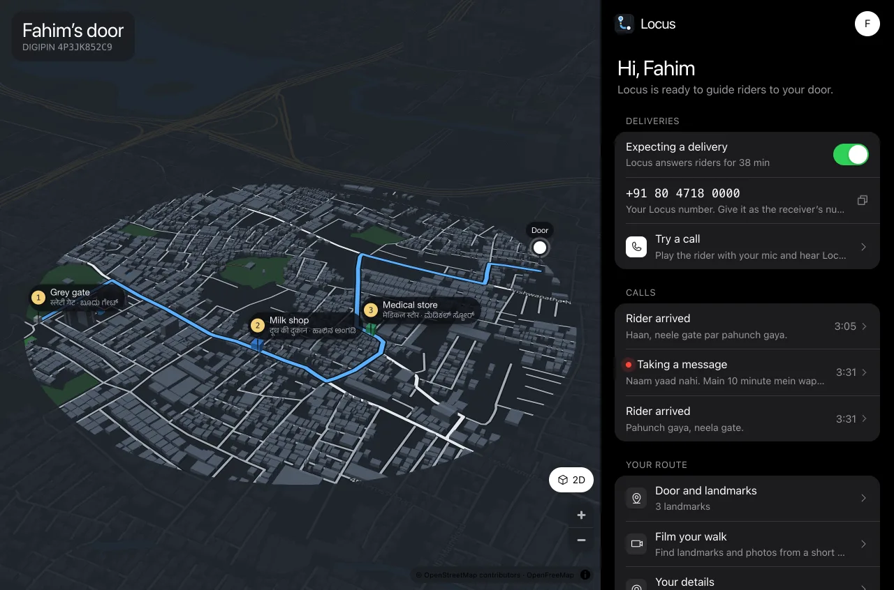
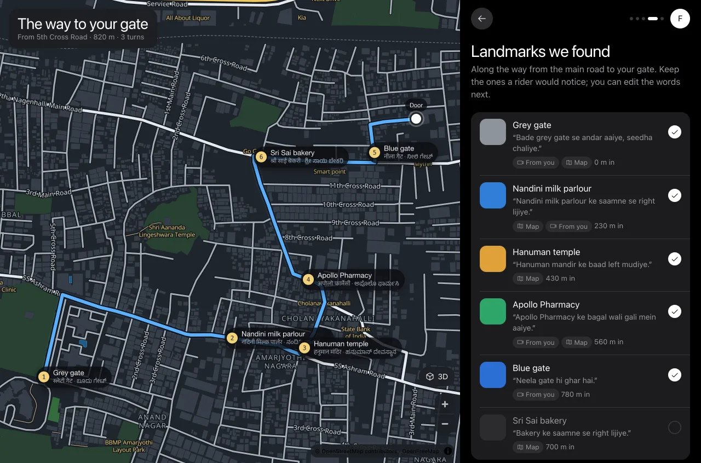
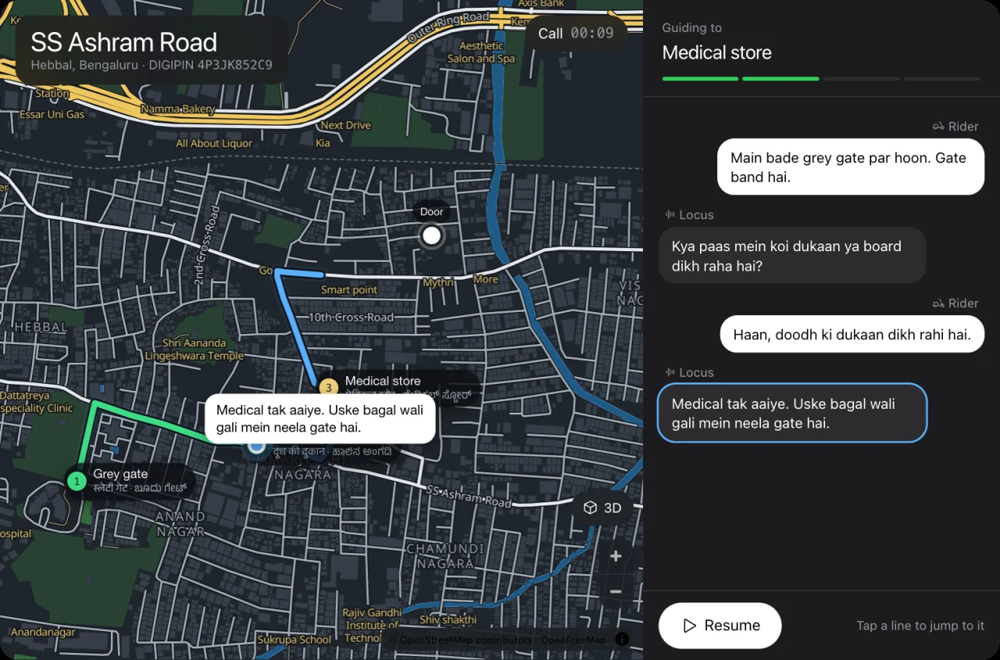
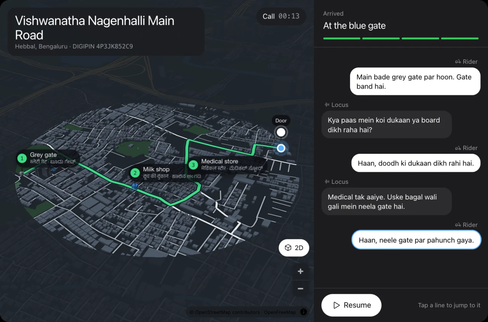
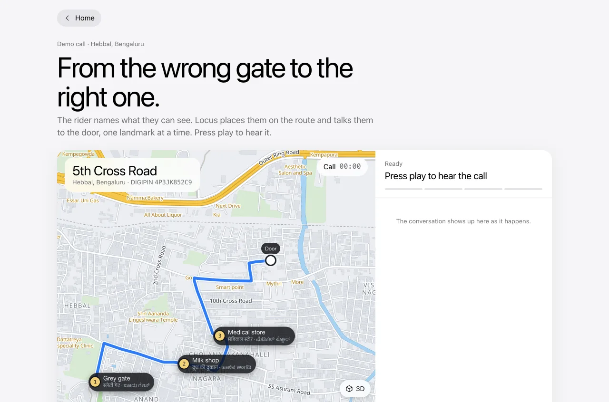
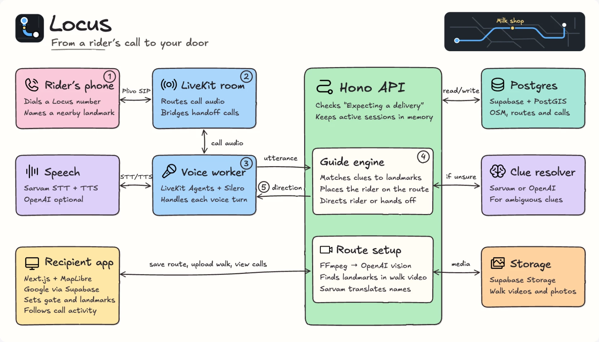

# Locus

Locus answers a delivery rider's call in Hinglish and talks them to your door, one landmark at a time.

Riders in Indian neighbourhoods get lost in the last 200 metres: same-looking lanes, gates without numbers, a pin that lands on the wrong building. Locus knows the way in from the main road and the landmarks a rider can actually see on it. When the rider calls, it works out where they are from what they describe and gives the next turn.

Try it at [locus.ahmedfahim.dev](https://locus.ahmedfahim.dev), or [hear the demo call](https://locus.ahmedfahim.dev/replay) without signing in.



## How it works

1. Set up your door once. Pin your gate, then film a short walk from the main road or add a few photos. Locus combines what it sees with OpenStreetMap, drafts the route from the nearest main road and suggests landmarks along it, each with a line in Hinglish.
2. Turn on "Expecting a delivery". Give your Locus number as the receiver's number when you order, or forward calls to it.
3. The rider calls. Locus checks they know your first name and the app, asks what they can see, places them on the route and gives the next direction. If it can't place them, it rings you and connects the call.

| Landmarks found during setup | A finished call |
|:---:|:---:|
|  |  |

| Demo call, guiding | Demo call, arrival in 3D |
|:---:|:---:|
|  |  |

The app follows the system theme; here is the demo call in light mode:



Screenshots use a demo account and sample landmarks on real streets in Hebbal, Bengaluru.

## What's inside

| Part | What it does | Built with |
|---|---|---|
| `apps/api` guide API | Screening, placing the rider on the route, the next instruction, handoff to the recipient, loop guards | Hono, Drizzle, Postgres with PostGIS |
| `apps/api` call worker | Answers the call, transcribes the rider, speaks Locus's reply | LiveKit Agents, Sarvam Saaras v4 (speech to text) and Bulbul v4 (voice), LiveKit noise cancellation |
| Geography | Road graph and named places around each home, route from the nearest main road | OpenStreetMap via Overpass, DIGIPIN |
| Walk video and photos | Finds gates, shops and signs a rider would notice | OpenAI vision, FFmpeg |
| `apps/web` recipient app | Sign-in, setup, the delivery switch, test calls, call history | Next.js, MapLibre with OpenFreeMap tiles, Supabase Auth and Storage |

The guide API decides every word Locus says; the call worker has no language model of its own. Any voice agent can use the same API.

[](diagrams/architecture.html)

[Open the diagram as HTML](diagrams/architecture.html).

## Run locally

You need Node.js 22+, pnpm 10 and a Supabase project with Google sign-in. Copy [.env.example](.env.example) to `.env` at the repo root.

The demo call needs only the web app, with `SUPABASE_URL` and `SUPABASE_PUBLISHABLE_KEY` set:

```bash
pnpm install
pnpm --filter @locus/web dev
```

Then open `http://localhost:3000/replay`.

For the full app, add `http://localhost:3000` to Supabase's redirect URLs, fill in the API settings in `.env` (plus `SUPABASE_SECRET_KEY` for Storage) and install FFmpeg. Import the streets around your gate, using its coordinates and a radius in metres:

```bash
pnpm --filter @locus/api db:migrate
pnpm --filter @locus/api osm:import 13.038 77.594 700
pnpm --filter @locus/api dev
```

Browser test calls also need LiveKit credentials and a worker key. Create the key, save it as `LOCUS_WORKER_API_KEY`, then start the worker in another terminal:

```bash
pnpm --filter @locus/api admin client locus-worker --first-party
```

```bash
pnpm --filter @locus/api worker dev
```

Phone calls also need a SIP trunk (Plivo or Vobiz) and a Locus number assigned to the recipient with `admin number`.

## Test

```bash
pnpm test
```

```bash
pnpm typecheck
```

The API tests drive the HTTP routes against an in-memory store, so they need no database or keys.
