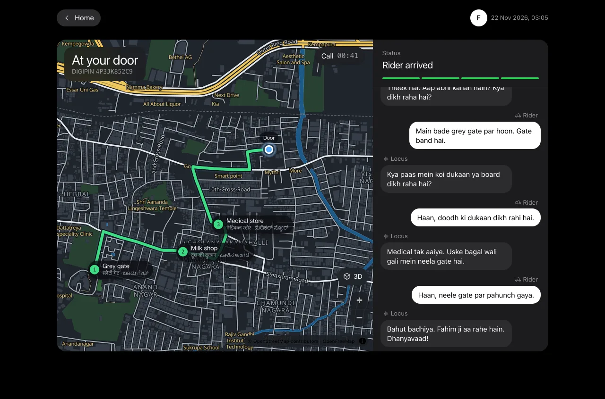

# Locus

Locus answers a delivery rider's call in Hinglish and talks them to your door, one landmark at a time.

Riders in Indian neighbourhoods get lost in the last 200 metres: same-looking lanes, gates without numbers, a pin that lands on the wrong building. Locus knows the way in from the main road and the landmarks a rider can actually see on it. When the rider calls, it works out where they are from what they describe and gives the next turn.

## Try Locus

### Hear the demo without signing in

Open the demo and select “Play the call”. Follow the rider from the grey gate to the blue gate as the transcript and map update. Select a transcript line to jump to it, or switch the map to 3D. The replay uses scripted Hinglish audio, sample landmarks, and real streets in Hebbal, Bengaluru. [Play the demo](https://locus.ahmedfahim.dev/replay)

### Test the live guide in your browser

1. Sign in with Google. Enter your first name, choose a delivery app such as Swiggy, and add a phone number you control in international format. Add a short message for Locus to read if you miss a handoff, such as “Leave it with the security guard.” [Open Locus](https://locus.ahmedfahim.dev)
2. Pin a gate in an Indian neighbourhood you know. You can skip the walk video and use map suggestions or choose “Add landmark at the pin” to enter your own. Pick two recognisable landmarks along the approach, give each a short direction, then select “Save route”.
3. On Home, turn on “Expecting a delivery”. Select “Try a call”, then “Start call”, and allow microphone access. This browser test works without an assigned Locus phone number. [Open the test-call screen](https://locus.ahmedfahim.dev/test-call)
4. Play the rider. Say “Anita ke liye, Swiggy se”, substituting your first name and chosen app. When asked where you are, name a saved landmark, for example “Main milk shop ke paas hoon.” Name the next landmark when prompted. Check that the transcript, map progress, and spoken directions agree with your saved route. End the call and open it from “Calls” on Home to review the transcript.

For a screening check, start another call and give the wrong recipient name. Confirm that Locus asks for the name again and withholds route directions. If the browser blocks the mic, enable it for this site and retry.

### Test a phone call or handoff

If Home shows a Locus number, turn on “Expecting a delivery” and dial that number from another phone. If “Call the rider” appears under “Try a call”, leave your own `+91` number in the field and answer when it rings. To test a handoff, pass screening and say “Customer se baat karao”. Use separate rider and recipient phones you control so you can answer both legs. These phone options depend on the Vobiz SIP configuration and account setup.


## How it works

1. Set up your door once. Pin your gate, then film a short walk from the main road or add a few photos. Locus combines what it sees with OpenStreetMap, drafts the route from the nearest main road and suggests landmarks along it, each with a line in Hinglish.
2. Turn on "Expecting a delivery". Give your Locus number as the receiver's number when you order, or forward calls to it.
3. The rider calls. Locus checks they know your first name and the app, asks what they can see, places them on the route and gives the next direction. If it can't place them, it rings you and connects the call.

In real use the rider calls you and your number forwards the call to Locus, which answers on your behalf. For demos without setting up forwarding, "Call the rider" on the test-call screen has Locus dial a phone instead: the same screening, guidance and voice, just started from the other end.

| Landmarks found during setup | A finished call |
|:---:|:---:|
|  |  |

| Demo call, guiding | Demo call, arrival in 3D |
|:---:|:---:|
|  |  |

## What's inside

| Part | What it does | Built with |
|---|---|---|
| Phone calls | Receives calls to the Locus number and dials out for rider calls and handoffs | Vobiz phone numbers and SIP trunks, LiveKit Cloud |
| `apps/api` guide API | Screening, placing the rider on the route, the next instruction, handoff to the recipient, loop guards | Hono, Drizzle, Postgres with PostGIS |
| `apps/api` call worker | Answers the call, transcribes the rider, speaks Locus's reply | LiveKit Agents, Sarvam Saaras v4 (speech to text) and Bulbul v4 (voice), LiveKit noise cancellation |
| Geography | Road graph and named places around each home, route from the nearest main road | OpenStreetMap via Overpass, DIGIPIN |
| Walk video and photos | Finds gates, shops and signs a rider would notice | OpenAI vision, FFmpeg |
| `apps/web` recipient app | Sign-in, setup, the delivery switch, test calls, call history | Next.js, MapLibre with OpenFreeMap tiles, Supabase Auth and Storage |

The guide API decides every word Locus says; the call worker has no language model of its own. Any voice agent can use the same API.

The API and call worker run on AWS EC2. Vercel hosts the web app, and Supabase provides Postgres with PostGIS, Google sign-in and media storage.

[](diagrams/architecture.html)

[Open the diagram as HTML](diagrams/architecture.html).

## Run locally

For the local setup, follow the runbook in [AGENTS.md](AGENTS.md#2-configure-the-local-environment). It covers where to get each environment variable, Google sign-in, PostGIS migrations and map import, the LiveKit worker, and Vobiz SIP setup. The [credential-free checks](AGENTS.md#1-install-and-run-credential-free-checks) run without provider accounts.

## Test

```bash
pnpm test
```

```bash
pnpm typecheck
```

The API tests drive the HTTP routes against an in-memory store, so they need no database or keys.

## License

MIT, see [LICENSE](LICENSE).
