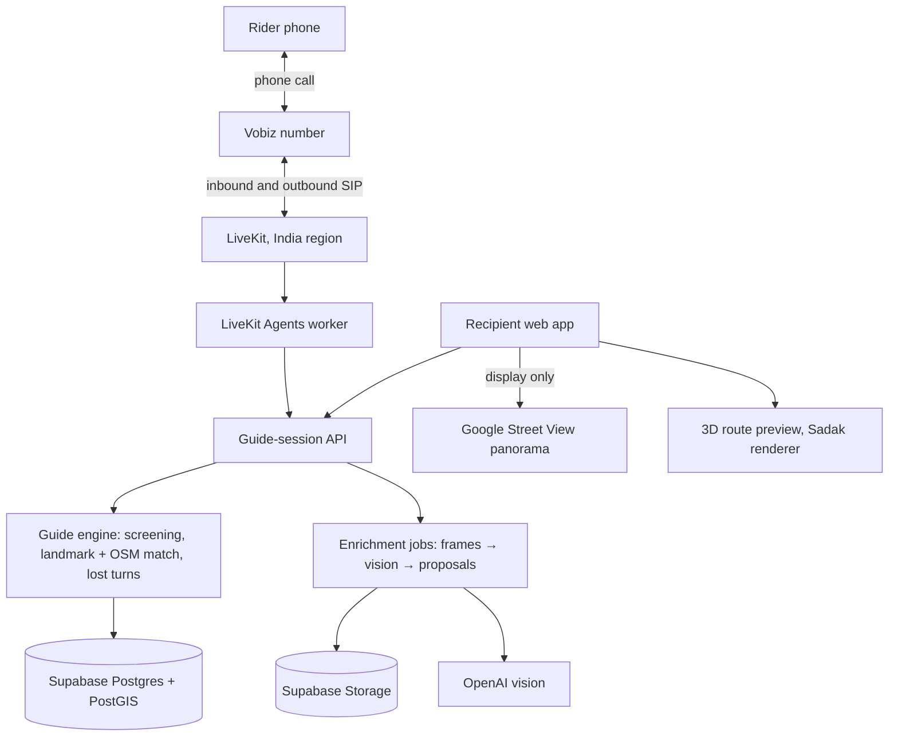

# Locus — Implementation Plan

> Thesis: when a delivery rider calls, an AI answers in Hinglish and talks them to the recipient's exact door. Unlike cue-only assistants, Locus grounds every instruction in real geography: OpenStreetMap places and roads around the home, plus street-level landmarks the recipient sets up once from their own walk video. Built as a guide-session API that a call assistant such as Equal AI can adopt.
>
> Track: Build Challenging — Voice AI for India. Locus is the team's only project (Here was dropped on 2026-11-21).
>
> Updated: 2026-11-21. Design source: office-hours doc `~/.gstack/projects/ahmedfahim21-Locus/ahmedfahim-main-design-20261121-160159.md` (approach B), extended by this revision.

## Status and next steps (2026-11-22)

Read DESIGN.md before any UI work (Spatial Agents chrome, Sadak map colours, since 2026-11-22). Secrets live only in the root `.env` (never committed); see `.env.example`.

Done and tested (`pnpm typecheck`, `pnpm test`: 93 API tests):
- Guide-session API, screening, matching, road graph, handoff and loop guards, Supabase store and auth.
- Matching handles Sarvam's Devanagari output: consonant-skeleton comparison ("अहमद स्विगी" → Ahmed, Swiggy; "कोहिनूर" → Kohenur) and names split in two ("fil dos" → FilDOS).
- When the rider reaches a landmark, Locus says that landmark's own text ("What Locus says there"); the last landmark means arrived. An OSM place within 20 m of a landmark not yet reached counts as that landmark.
- Walk-video pipeline (section 4.6) on Supabase Storage, with a sweep that deletes videos older than a day. Typed landmarks are spelled in Hindi and the home state's script (Telugu or Kannada) by Sarvam transliterate, as they sound ("नॉलेज सिटी", not "ज्ञान नगरी").
- `osm:import` works (imported 35 places and 248 roads around the demo home). Overpass mirrors are often overloaded: retry, or set `OVERPASS_URL`.
- `pnpm eval <recipientId> [phrases.jsonl] --ablation` scores typed only / + OSM / + walk landmarks. A 10-phrase dev run: 60% with 2 wrong landmarks named → 90% with none.
- Web app on DESIGN.md (Spatial Agents chrome, Sadak map colours): light and dark themes with an appearance switch, map labels, a brand mark (`app/icon.svg`), and a 3D view. In 3D, buildings rise from OSM heights and each landmark stands up as a prop in its colour; the walk-video model reports each landmark's kind and colour (verified on the painted-board video: green, rust and saffron came back within a few shades).

Voice, end to end without a phone number (verified):
- Sarvam models: speech-to-text `saaras:v4` with per-call key terms (name, apps, landmarks, nearby places; sent through `patches/@livekit__agents-plugin-sarvam@1.10.1.patch`), voice `bulbul:v4-flash` (`simran_hi_conversation`), fallback matcher `sarvam-105b-conversations`, names `sarvam-translate:v1`. On phone audio, key terms turn "बहिन" back into "फहीम" (Fahim) and "Kohinoor" into "Kohenur".
- Try a call from the web app: Home → "Try a call" (`/test-call`). `POST /me/test-call` issues a LiveKit token whose server-set attribute names the recipient; the worker runs the normal screening and guide loop.
- Scripted: `livekit-server --dev`, `pnpm --filter @locus/api start`, `pnpm --filter @locus/api worker dev`, then
  `pnpm --filter @locus/api voice:rider eval/voice-run --recipient rcp_dev_ahmed -- "Fahim ke liye hai, Swiggy se" "ITC Kohenur ke paas hoon" "Knowledge City aa gaya" "Qualcomm ke saamne hoon"`.
  Dev recipient `rcp_dev_ahmed` (first name Fahim, Hyderabad, near the demo home). `voice:rider --token` prints a token for the LiveKit agents playground.
- Measured: rider stops → Locus starts talking 2.1–4.3 s (median 2.2–4.0 s across runs; the spread is speech-to-text end-of-turn). The API part is ~1.0 s, mostly round trips to Supabase in Sydney.

Needs your accounts or hands (in this order):
1. Phone verification: call the Vobiz Locus number and verify LiveKit dispatches `locus-guide`. Trigger a handoff and confirm that the Vobiz outbound trunk connects the recipient. See the [phone setup in the README](README.md#run-locally).
2. Move Supabase to Mumbai (ap-south-1): saves ~0.8 s per rider turn.
3. Deploy: API and worker on one EC2 in ap-south-1 behind Caddy (ffmpeg installed), web on Vercel; set `LOCUS_WEB_ORIGIN`, `LOCUS_API_URL`, the Supabase auth redirect, and the LiveKit keys (test calls need them too).
4. Demo through a friend's phone: they order on Swiggy or Zomato with the receiver's number set to the Locus number.
5. Record a real walk on a phone over HTTPS (after step 3).
6. Record 40 real rider phrases for the demo home into `eval/phrases.jsonl`; run `pnpm eval <recipientId> --ablation`.

Optional: Sarvam Voice Agents as the "Equal adoption" demo (a Voice Agents agent calling the guide API as an HTTPS tool). Not the main call path: its LLM rephrases tool results and can't speak the recipient's instructions verbatim.

Known gaps: OSM names with numbers ("T-hub 2.0") tokenise poorly and can go to the fallback model; stamps overlap when landmarks are close; the 3D route preview (Sadak port) has its own owner.

## How a real call works, and deploying it

End to end:
1. A rider taps "call customer" in the Swiggy or Zomato app. The platform's number masking places a fresh call to the receiver's number.
2. That number is the Locus number (set as the receiver's number when ordering, or the recipient forwards unanswered calls to it).
3. Vobiz provides the number and sends the call to LiveKit's inbound SIP trunk.
4. LiveKit's dispatch rule puts the call in a new room and dispatches the `locus-guide` worker.
5. The worker asks the API for a session for that number (`POST /v1/sessions`), gets the greeting and the call's key terms, and starts Sarvam speech: `saaras:v4` listening for those key terms, `bulbul:v4-flash` speaking.
6. Each rider turn goes to the API (`POST /v1/sessions/:id/utterances`), which runs screening, matching and the route, and returns the exact sentence to say.
7. If Locus loses the rider twice, the API answers "handoff" with the recipient's phone. The worker dials it through the LiveKit outbound trunk to Vobiz and bridges the rider in, or plays the recipient's note if nobody answers.
8. The recipient's web app shows the call live (`/me/calls`, polled), on the map, while it happens.

What runs where:
| Piece | Where | Notes |
|---|---|---|
| API (`apps/api`, `pnpm --filter @locus/api start`) | One EC2 instance in ap-south-1, behind Caddy (HTTPS) | Needs ffmpeg for walk videos. Public: the web app and the worker call it. |
| Call worker (`pnpm --filter @locus/api worker start`) | Same EC2 instance | Connects out to LiveKit; no public port. |
| Web app (`apps/web`) | Vercel (project root `apps/web`) | Env: `SUPABASE_URL`, `SUPABASE_PUBLISHABLE_KEY`, `LOCUS_API_URL`. |
| Database, sign-in, storage | Supabase | Move the project to Mumbai for latency (~0.8 s per turn). |
| Calls | LiveKit Cloud, India region | Inbound trunk, dispatch rule, outbound trunk. |
| Phone number and SIP carrier | Vobiz | Inbound PSTN calls and outbound dialling. |
| Speech | Sarvam API | Already set up. |
| Vision, Street View | OpenAI; Google Maps (`GOOGLE_MAPS_API_KEY`, Street View Static API enabled) | Street View is optional. |

Deploy steps:
1. EC2 with Docker (what runs now: `locus-api.ahmedfahim.dev` on 3.111.53.34): ports 80 and 443 open in the security group, an A record for the API name pointing at the instance. Put the production env at `infra/.env.production` (gitignored; `API_DOMAIN`, `LOCUS_API_URL`, comma-separated `LOCUS_WEB_ORIGIN`), copy the repo to `~/locus` on the server (from zsh, write `"${H}:locus"`, since `$H:l` is a zsh modifier), then on the server:
   `docker compose -f infra/docker-compose.yml --env-file infra/.env.production up -d --build`
   This builds `apps/api/Dockerfile` and starts the API plus Caddy, which gets the TLS certificate. Add `--profile calls` once LiveKit keys are in the env to start the call worker too. Without Docker, `bash infra/setup-ec2.sh api.yourdomain.in` sets up the same thing on Ubuntu with systemd.
2. `.env` on the server: everything in `.env.example`, with `LOCUS_API_URL=https://api.yourdomain.in`, `LOCUS_WEB_ORIGIN=https://<your Vercel domain>`, the LiveKit Cloud URL and keys, and no `LOCUS_DEV_DID`. Create the worker's key with `pnpm --filter @locus/api admin client locus-worker --first-party` and set it as `LOCUS_WORKER_API_KEY`.
3. Vercel: import the repo, root directory `apps/web`, set the three env vars, deploy. Add the Vercel URL to Supabase Auth's redirect URLs.
4. LiveKit Cloud: create a project (India region). Install the `lk` CLI. Point the Vobiz number's SIP origination at the project's SIP URI. Then:
   - `lk sip inbound create infra/livekit/inbound-trunk.json` (your number filled in)
   - `lk sip dispatch create infra/livekit/dispatch-rule.json` (the inbound trunk id filled in)
   - Set the `VOBIZ_SIP_*` credentials and run `pnpm --filter @locus/api admin trunk +91XXXXXXXXXX`. Save the printed `LIVEKIT_SIP_OUTBOUND_TRUNK_ID` and `LOCUS_OUTBOUND_NUMBER`.
5. Tell Locus the number belongs to the recipient: `pnpm --filter @locus/api admin number +91XXXXXXXXXX <recipientId> vobiz`, and `admin outbound +91XXXXXXXXXX` for the loop guard.
6. Test: turn on "Expecting a delivery", call the number from a friend's phone, then do it for real with a Swiggy order whose receiver number is the Locus number.

## 0. What changed in this revision

- Here is dropped; Locus (formerly Pata) is the primary and only idea. All effort goes here.
- Equal AI reviewed the idea positively. They are attacking the same problem but rely only on what the user says; they don't use geospatial data, and the problem stays unsolved for them. Locus's pitch to Equal is that missing layer: geography plus street-level landmarks, behind the guide-session API.
- Setup gets richer, scoped by a feasibility pass (2026-11-21): typed landmarks plus the recipient's own walk video are the core; a display-only Street View look-around and Ola Maps street-level imagery are optional; Mapillary is out for the hackathon (section 4.6).
- No scraping of Google Street View. Google's terms forbid scraping, storing or deriving data from it. Street View appears only as a live, display-only panorama in setup; any landmark taken from it is the recipient's own words and pin.
- New: a 3D route preview in the recipient app, a trimmed port of Sadak's OSM → three.js renderer, built in parallel by a second owner (section 4.7). The 2D map with landmark photos stays as the fallback view.
- New hypothesis P4 and an ablation that directly supports the Equal pitch: cue-only vs + OSM vs + street-level cues (section 6).
- Providers are set by the credits the team has (section 4.9): Sarvam for call speech and the fallback matcher, OpenAI for walk-video vision and as the comparison arm, AWS Mumbai (one EC2 instance) for the API and worker, Supabase for Postgres + PostGIS, sign-in and media storage.
- The masked-call front door (P10) is un-deferred into the Day-1 kill test: without it, real deliveries never reach Locus.
- Sarvam's hosted Voice Agents platform is not Locus's call layer (its own LLM writes every reply and every call is recorded), but it is the demo's stand-in for Equal: a third-party voice agent that calls the guide-session API as a tool (section 4.4).

## 1. Hypotheses

- P1 — A rider guided by Locus reaches the gate faster, with fewer calls, than the same route guided by the recipient over the phone.
- P2 — Locus hands off honestly: when it loses the rider it rings the recipient instead of guessing.
- P3 — Recipients would forward rider calls to Locus, and riders accept an AI answering. Checked with 5–8 recipients and the riders in test runs, not assumed.
- P4 — Geography beats cues alone. On the same rider phrases, matching accuracy rises from typed cues only (the Equal baseline), to + OSM places and roads, to + walk-video landmarks with aliases. Measured by the matching-eval ablation (section 6), not assumed.

### Claims we will not make

- Locus does not know the rider's live position unless the rider states it. It localizes from speech against cues and nearby OSM features.
- Locus is not integrated with Equal AI. "Adoptable" means a documented guide-session API that Equal has seen.
- Locus never scrapes, stores or runs models on Google Street View imagery. Street View is a live view in setup only.
- Landmarks proposed from walk video are suggestions until the recipient confirms them.
- DIGIPIN encodes the confirmed coordinate; it says nothing about whether the coordinate is right.
- Time-to-gate improvements are measured on teammate and friend runs, not on real delivery traffic.
- "Nothing stored" in no-transcript mode refers to Locus's own storage. STT and LLM vendors may retain data under their own policies unless zero-retention is confirmed per vendor.

## 2. Journey

1. Recipient setup (once), in the web app:
   - Place the handoff pin on the map (DIGIPIN computed).
   - Build the route (section 4.6): record a 30–60 s walk video from the main road to the door and confirm the landmarks it proposes, type landmarks, and optionally look around in Street View to check them.
   - Review proposed landmarks (photo where the source allows, suggested name, aliases such as sign text or the Hindi name), confirm, edit or drop each, and order them along the route.
   - Check the route on the map with landmark photos, or in the 3D preview (section 4.7).
   - Switch on "expecting a delivery" and set call forwarding to the Locus number (or give the Locus number as the receiver's contact where the app allows it).
2. A rider calls the recipient's Locus number, or the recipient's own number forwards on busy/no answer.
3. Spoken notice: "This call is answered by an AI assistant and transcribed to guide you."
4. Screening: first name and delivery app.
5. Guide loop: "Where are you now?" → match against confirmed landmarks (names and aliases), then OSM features near the pin → next instruction → repeat until the rider is at the gate.
6. Handoff on two lost turns or on request: ring the recipient once and bridge, or play the fallback note.
7. Recipient watches the live transcript (watch-only; take-over deferred, D35).

## 3. Day 1–2 kill test

Telephony and the front door are the biggest risks; walk-video work does not start until these pass.

- [ ] Number: configure the Vobiz number and SIP trunks using the [Vobiz LiveKit integration guide](https://www.vobiz.ai/integrations/livekit/).
- [ ] Spike: inbound call → SIP trunk → LiveKit (India endpoint, region pinning) → Locus worker → Hinglish greeting.
- [ ] Latency: full turn (rider stops speaking → first audio) on a real mobile call, Sarvam (default) vs OpenAI (`LOCUS_SPEECH_PROVIDER`). Record the number.
- [ ] Front door (P10): place one real Swiggy or Zomato order with the recipient's phone forwarding to the Locus number; record whether the masked rider call arrives and what caller ID it shows. Also try Swiggy's receiver-number field with the Locus number.
- [ ] Geography: `osm:import` around the demo home; record how many named places and named roads lie within 500 m.
- [ ] Guide loop with one teammate's real route; one teammate-as-rider guided to the real gate.

| Outcome | Decision |
|---|---|
| Number answers in Hinglish and one teammate-as-rider is guided to a real gate | Go |
| Guide loop works, but no number is approved yet (KYC pending) | Go: provider trial number or WebRTC browser dial-in; KYC tracked as a blocker |
| Full turn over ~2 s on both speech providers | Pivot: pre-recorded guide voice note plus the pin through the delivery app chat |
| Masked platform call does not survive forwarding, and no receiver-number field works | Keep building, but the demo uses a direct call to the Locus number and says so; ask Equal how their users' calls arrive |
| Fewer than ~10 named places within 500 m in OSM | Add Ola Maps Nearby Search as a live (uncached) second source of nearby places |
| Guide loop can't match a rider's stated position on the demo route | Stop the live guide |

## 4. Architecture



Stack: TypeScript, pnpm workspaces, Hono API, Next.js recipient app, Supabase (Postgres + PostGIS, Auth with Google), Drizzle, LiveKit Agents (Node) over SIP, Vitest. Speech and models per section 4.9 (Sarvam, OpenAI); walk videos in Supabase Storage; API and worker on AWS EC2 in Mumbai. New for street-level cues: three.js (3D preview, as in Sadak), ffmpeg for frame extraction; optionally the Google Maps JavaScript API (Street View panorama, display only). The web app and the voice worker both go through the API; nothing else reads the DB directly.

### 4.1 Number mapping and screening

- One virtual number per recipient. Inbound calls map to a home profile by the dialled number (DID), never by caller ID. No match → "this number isn't set up", hang up.
- Spoken notice first. An objection never skips screening. An objecting caller who passes screening goes straight to handoff in no-transcript mode; one who fails screening only gets take-a-message.
- Guidance is active only while "expecting a delivery" is on (auto-off after 3 hours) and the caller names both the recipient's first name and the platform (P4/D41). Otherwise no cue text is ever spoken.

### 4.2 Guide loop

- Match the rider's answer against confirmed landmarks (name and every alias), then OSM features within 500 m of the pin. Name match first; OpenAI only when it finds nothing (P9). Weak words alone (lane, road, gate…) never match.
- Matched landmark k → its next step. Matched a non-landmark OSM feature → one street-name step to rejoin the route at the next landmark not yet reached (a later one only if the rider is within 60 m of it), never left/right (P5). Changed 2026-11-22 from "nearest remaining landmark": at the Equal office a rider at ITC Kohenur was sent towards the door, which is nearer as the crow flies than the gate he has to come in by.
- Arrival = rider names the final landmark (the gate or door).
- Lost turn: no match; 8 s silence; "that's wrong"; unsupported language. Two in a row → handoff.

### 4.3 Handoff

- Trigger: two lost turns, or the rider asks for a person. Ring the recipient once from Locus's outbound number; answered within 20 s → bridge; otherwise the fallback note and a summary.
- Loop guards: Locus numbers rejected; the recipient's DID rejected during the handoff leg and for 60 s after (P3, D40/D49).

### 4.4 Guide-session API (the adoptable surface for Equal)

- `POST /v1/sessions`, `POST /v1/sessions/:id/utterances`, `POST /v1/sessions/:id/handoff-result`, `POST /v1/sessions/:id/end`.
- Per-client API keys. Responses carry only the next spoken instruction, never the pin or landmark list. The server owns the state machine (P2). Only first-party clients receive `handoffPhone`; Equal hands off to its own user.
- Adoption demo with Sarvam Voice Agents as Equal's stand-in: a Sarvam agent on its own number, with an on-start API tool that opens a Locus session (static `recipientId` per agent, since Sarvam doesn't document passing the dialled number) and a per-turn API tool that posts the rider's words to `/utterances` and speaks the returned instruction through a response template. Sarvam's built-in call transfer covers handoff. Known limits, stated in the demo: Sarvam's LLM sits between Locus and the rider (it may paraphrase), every call is recorded (no objection mode), and the agent answers 09:00–18:00 IST by default.

### 4.5 Data model (camelCase, `locus` schema)

Existing: `apiClients`, `recipients`, `homeProfiles`, `cues`, `numbers`, `outboundNumbers`, `osmFeatures`, `osmWays`, `osmWayNodes`, `sessions`, `turns`.

Changes for street-level landmarks:
- `cues` gains `aliases text[]` (sign text, Hindi/Kannada names, "neela gate"), `source` (`typed | walkVideo | streetView`), `photoPath` (Supabase Storage path; walk-video frames only, never Street View).
- `mediaUploads(id, recipientId, storagePath, kind, durationS, gpsTrack jsonb, status, createdAt, deletedAt)`. The GPS track is read whole with the video.
- `landmarkProposals(id, recipientId, source, name, aliases, kind, location, photoPath, confidence, osmId, status (proposed | accepted | rejected), createdAt)`. Queried by recipient and status, so explicit columns.

The matcher already takes several names per candidate; aliases go straight into it.

### 4.6 Street-level cue sources

All sources end the same way: proposals the recipient confirms, orders and edits on the map. Only confirmed landmarks reach the guide loop.

| Source | Status | Why |
|---|---|---|
| Typed landmarks | Built, core | Baseline, and the cue-only arm of the P4 ablation (what Equal does today) |
| Walk video → vision proposals | Core, Days 5–9 | Own data, covers every lane, legal to process |
| Aliases on landmarks | Core, small | Video sign text and Hindi spellings become extra names the matcher already accepts |
| Street View look-around | Optional | Display only; checks landmarks by eye but adds no matching data |
| Ola Maps street-level imagery | Optional, after reading its terms | Bengaluru street-view API; if its terms allow processing it beats Google for this |
| Mapillary | Out for the hackathon | No evidence of residential-lane coverage in Bengaluru; walk video covers one home better |
| Sarvam transliteration for aliases | Out unless the eval shows script misses | The matcher already romanizes Devanagari and fuzzy-matches |

**Walk video, end to end:**
- The recipient records 30–60 s from the main road to their door in the web app (MediaRecorder over HTTPS); the browser records a GPS track alongside (Geolocation `watchPosition`).
- The API creates a signed upload URL for a private Supabase Storage bucket. The browser sends the video to Storage and the GPS track to the API.
- The API extracts frames every ~10 m along the track (ffmpeg, in-process on the EC2 instance), sends them in batches to an OpenAI vision model with a strict schema (landmark name, kind, colour, sign text, side if visible, confidence), dedupes across frames, and attaches each to the GPS point of its frame.
- Each proposal is snapped to a nearby OSM feature when names agree (adds `osmId` and the OSM name as an alias).
- The API deletes the video after processing. A sweep removes stale uploads, and unselected landmark frames are removed when the recipient saves their route.

**Street View look-around (optional):** the Maps JavaScript API panorama opens at points along the route; the recipient types what they see and drops it on the map. Nothing from the panorama is captured, stored or sent to a model.

### 4.7 3D route preview (trimmed Sadak port, parallel owner)

- Sadak builds scenes offline in Node: `scripts/osm/fetch.ts` (Overpass) → `scripts/osm/build.ts` (projects to metres, street graph, procedural plots, real shop boards) → `MapData` JSON, rendered by plain three.js builders (`world/roads.ts`, `world/buildings.ts`, `lib/game/buildings.ts`, `signage.ts`, `world/boards.ts`, `materials.ts`).
- Locus ports those into `apps/web/components/scene3d` (renderer) and `apps/api/src/scene` (builder). About 5,500–6,500 lines copy with light edits; about 600–900 new: a slim `buildStaticScene` replacing Sadak's game-tied `buildWorld`, a React mount, a route ribbon (reusing `ribbon()` / `offsetPolyline()` from `world/roads.ts`), numbered landmark sprites and a CatmullRom fly-through camera.
- The API builds each home's scene JSON from the OSM extract and serves it at `GET /me/scene`.
- Scope: roads, buildings and real shop boards only. No NPCs, vehicles, clutter or post-processing. Pixel ratio capped for phones.
- Owner: a second team member, Days 3–10, in parallel with the walk-video work. If it isn't ready, the 2D map with landmark photos is the setup view and the demo.
- Licences: OSM data is ODbL (attribution shown); Sadak's cel-shader files carry an MIT notice; add a LICENSE to the Sadak repo before copying.

### 4.8 Repo layout

```text
Locus/
  apps/web/              # recipient app: setup, sources, 3D preview, live calls (Vercel)
    components/scene3d/  # ported Sadak renderer (static scenery only)
  apps/api/              # Hono: guide-session API, /me routes, enrichment jobs, worker, scripts
    src/enrich/          # walk-video frames → vision proposals; OSM snapping
    src/scene/           # per-home 3D scene builder (ported from Sadak)
    src/voice/           # LiveKit Agents worker
    src/clues/ src/geo/ src/digipin/ src/guide/ src/store/
  eval/                  # matching-eval phrases (not committed) and ablation results
```

### 4.9 Providers and where each runs

| Need | Provider | Notes |
|---|---|---|
| Call speech-to-text | Sarvam Saaras v3 (`codemix`, language auto) | Default; OpenAI transcription is the comparison arm (`LOCUS_SPEECH_PROVIDER`) |
| Call text-to-speech | Sarvam Bulbul v3 (speaker `simran`, `hi-IN`/`en-IN`) | Default; OpenAI TTS is the comparison arm |
| Fallback position matching | Sarvam `sarvam-105b` (JSON mode) | Default; OpenAI `OPENAI_MODEL` with strict structured output is the other arm (`LOCUS_RESOLVER_PROVIDER`). Eval 2026-11-22 (40 phrases on the dev home, local `eval/phrases.jsonl`; 18 reach the fallback). First run: Sarvam 80%, OpenAI 90%; most misses were the model copying long map ids wrong ("way/1133460475" for "way/1133460476"). With short labels (p1, p2, …), generic words ("city", "park", "tower") no longer matching on their own, and stricter instructions: Sarvam 92.5% (same on two runs, one false landmark: "Mindspace" → Knowledge City), OpenAI 100%. Latency from the Mumbai server: Sarvam ~0.1 s, OpenAI ~1.8 s. Sarvam stays (owner's call) |
| Landmark aliases (Hindi/Kannada spellings) | Sarvam transliteration | Adds script variants of each confirmed landmark name |
| Walk-video and photo vision | OpenAI `gpt-6.1-terra` (`OPENAI_VISION_MODEL`) | Strict schema; proposals only; calls never use it. 2026-11-22, on 3 stored landmark crops: all five candidates read the signs alike; Terra and the GPT-6.2 models got every place type right (`gpt-5.4` and `-mini` each missed one); with no images, Terra and `gpt-5.4` returned nothing while `gpt-6.2-sol` and `-astra` invented 10 and 6 landmarks. Small sample: recheck on a full walk |
| Database, PostGIS, sign-in | Supabase | `locus` schema; Google sign-in |
| Walk videos and kept frames | Supabase Storage | Private bucket; the API issues signed video upload URLs and handles cleanup |
| API, frame extraction, LiveKit worker | One AWS EC2 instance in ap-south-1 behind Caddy (HTTPS) | The worker connects out to LiveKit and needs no public URL; the API must be public for the web app and the Sarvam adoption demo; ffmpeg runs in-process. No ECS or queues |
| Recipient web app | Vercel | Static + client; talks only to the API |
| Calls | LiveKit Cloud (India SIP endpoint, region pinning) + Vobiz | Vobiz provides the number and SIP trunks for inbound and outbound calls |
| Nearby places | OpenStreetMap; Ola Maps Nearby Search only if the Day-1 OSM count is low | Ola results used live, not stored, until its caching terms are checked |
| Adoption demo | Sarvam Voice Agents | Equal stand-in calling the guide-session API as a tool (section 4.4) |

## 5. Milestones

Built so far (2026-11-21): guide-session API with state machine, screening, landmark/OSM matching, road-graph steps, handoff and loop guards; DIGIPIN; Postgres store on Supabase (`locus` schema, migrations applied); LiveKit worker with Sarvam speech by default (typechecks, not yet run on a call); Sarvam and OpenAI fallback resolvers behind one switch; recipient app with Google sign-in, typed landmarks on a 2D map, delivery switch and live calls; 67 tests.

Day 1–2 — kill test (section 3): number, call spike, latency, masked-call front door, OSM count.

Days 2–4 — core on real calls
- [ ] First real guided arrival on the demo route; fix what breaks.
- [ ] Deploy API + worker on one EC2 instance in ap-south-1.
- [ ] `aliases` and `source` on cues; matcher uses aliases.
- [ ] Record and label 40 rider phrases.

Days 5–9 — walk video (section 4.6)
- [ ] Recording with GPS track, signed upload to Supabase Storage, frame extraction, vision proposals, OSM snapping, review UI, photo strip on the 2D map.
- [ ] Handoff end to end on a real call.

Days 10–11 — adoption demo
- [ ] Sarvam Voice Agent on a second number calling the guide-session API as a tool (section 4.4).

Days 11–14 — proof and demo
- [ ] P4 ablation (typed only vs + OSM vs + walk-video landmarks) and at least 10 guided runs plus control runs (P1).
- [ ] Demo rehearsal; Equal-facing API doc.

Parallel track, second owner (Days 3–10): 3D route preview (section 4.7).

Optional if time allows: Street View look-around; Ola Maps street-level imagery (after reading its terms).

After the hackathon: Mapillary, recipient take-over (D35), push notifications, approach C benchmark, more cities.

## 6. Tests and evaluation

Route-level Vitest tests on the API with mocked STT/LLM/telephony/vision; every returned field and before/after state asserted (existing list kept: number mapping, screening, objection, guide loop, handoff, loop guards, API privacy, DIGIPIN, state machine, off-route). New:
- Aliases: a rider phrase matching only an alias matches that landmark; aliases never let weak words match alone.
- Proposals: vision output outside the schema is rejected; proposals start `proposed`; only `accepted` ones become cues; rejecting leaves cues unchanged.
- Walk video: upload without a GPS track is refused; the video is deleted after extraction; frames of rejected proposals are deleted.
- Street View: no route accepts Street View imagery (no upload path exists for it).
- Scene payload: `/me/scene` returns only the recipient's own 500 m extract.

Matching eval (P8) and the P4 ablation: the same 40 labelled phrases scored three ways on the demo home: (a) typed cues only, (b) + OSM places and roads, (c) + walk-video landmarks with aliases. `pnpm eval <recipientId> --ablation` prints accuracy and false matches per arm. Demo gate unchanged: ≥ 85% and zero false cue matches on arm (c).

Evaluation runs (P1, P12): teammates and friends on real streets, different riders per arm, time-to-gate by GPS track, calls needed, handoff rate, lost turns.

## 7. Demo (2:30)

In the Air Agents style: real footage, one plain line per shot, one live moment, then how it fits together. Tagline on the landing page and the video: "A home set up once, a rider guided to the door out loud, and how it all fits together."

Lines for the actors, take by take: `demo/acting.md`.

Cast: Fahim (recipient, at home with the laptop and his phone) and a teammate (rider, on a scooter with a phone mount and a GoPro or second phone filming). Route: the dev home, from Dallas Centre road past ITC Kohenur and Knowledge City to the blue gate at Qualcomm.

| Time | Shot | On screen | Line (voice-over or caption) |
|---|---|---|---|
| 0:00 | Scooter stops at a junction. The rider's phone rings out, then a second call: "Bhaiya, location kidhar hai?" | Real footage, no UI | Every delivery in India ends with this call. |
| 0:08 | Title card on black, the Locus mark | Locus | Your door, explained out loud. |
| 0:12 | Sign in with Google; about you (name, apps, phone) | Setup, step 1 | Set up your home once. |
| 0:18 | Drop the door pin; the route draws from the main road with its turns | Setup, the map | Locus finds the way in from the main road. |
| 0:26 | Record a 30 s walk video, or add photos; suggestions appear from the map and the video | Setup, suggestions | It picks the landmarks a rider can see. |
| 0:36 | Confirm three; the 3D view of the street, the blue gate highlighted | 3D diorama | You check them, once. |
| 0:44 | Turn on "Expecting a delivery". Swiggy says the rider is 2 minutes away. Tap Call the rider | Try-a-call screen | When the rider is close, Locus calls them. |
| 0:50 | The rider's phone rings on the mount; he answers | Split screen: helmet cam left, Fahim's live call view right (stays for the call) | |
| 0:52 | Locus: "Namaste, main ek AI assistant hoon… Delivery kiske liye hai, aur kaunse app se?" Rider: "Fahim, Swiggy." | Transcript fills in live | It checks the rider first. |
| 1:02 | Locus: "Aap abhi kahan hain?" Rider: "ITC Kohenur ke paas hoon." Locus gives the next step | The dot moves to ITC Kohenur on the map | He tells it what he sees… |
| 1:14 | Rider: "Knowledge City dikh raha hai." Locus: towards Qualcomm | Dot moves on | …and it answers in his language. |
| 1:26 | Rider pulls up at the gate: "Qualcomm ke saamne hoon." | Arrived (the Qualcomm landmark is the door) | |
| 1:36 | Locus: "Bas, aap pahunch gaye. Shukriya!" Call ends | Call record: 3 landmarks, time to the gate | Door to door, no call to you. |
| 1:42 | Second take: the rider says "ek chai ki dukaan ke paas hoon", then "pata nahi bhaiya, kahin galat aa gaya". (Not "Mindspace": the resolver still places that at Knowledge City.) Locus: "Main unhe call kar raha hoon, line par rahiye." Fahim's phone rings | Handoff | When it can't place him, it doesn't guess. It calls you. |
| 1:56 | Rider: "Recording mat karo." Locus: "Theek hai, ab se kuch record nahi hoga…" | The transcript blanks | Riders can say no to being recorded. Walk videos are deleted within a day. |
| 2:04 | Architecture diagram builds step by step | `diagrams/architecture.html` | Phone call to LiveKit, Sarvam speech in Hinglish, then our guide API: the rider's words matched by name, Sarvam when they aren't. |
| 2:16 | Two numbers on white | 92.5% · 0.1 s | 92.5% of rider phrases placed right, in a tenth of a second. |
| 2:22 | The API in four lines: `POST /v1/sessions`, `POST /v1/sessions/:id/utterances` | Code card | Any voice assistant can use it. Equal included. |
| 2:27 | Mark and URL | locus.ahmedfahim.dev | Locus. |

Before the shoot:
- Two phones. "Call the rider" on your own number makes the handoff ring the phone already on the call; the rider must be on the teammate's phone.
- LiveKit Cloud keys, the outbound trunk and `LOCUS_OUTBOUND_NUMBER` on the server (set); call once end to end the day before.
- The dev home has "Expecting a delivery" on (it expires) and the three landmarks above confirmed.
- Record the call in a quiet lane first; road noise is the main risk to speech-to-text. Keep the best of three takes.
- Numbers on screen are from the eval in section 4.9 (40 phrases, dev home). No time-to-gate number until it's measured against a control run (claims, section 1).

Cut from the earlier outline: the Sarvam Voice Agents adoption segment (not built) and the ablation chart (not run). The API card at 2:22 carries the Equal point instead.

## 8. Risks

| Risk | Severity | Mitigation |
|---|---|---|
| Indian number KYC takes longer than Day 2 | High | Trial number or WebRTC fallback (section 3) |
| Voice latency on mobile calls | High | Day 1 spike; pivot row in section 3 |
| Rider's spoken position can't be matched | High | Landmark + alias matching, OSM fallback, honest handoff |
| Vision model invents landmarks | High | Proposals only; recipient confirms each; frame shown next to it |
| Masked platform calls don't survive forwarding | High | Day-1 test; receiver-number field; direct-call demo stated honestly |
| OSM thin around the demo home | Medium | Day-1 count; Ola Maps Nearby Search as a live second source |
| LiveKit India SIP outage on demo day | Medium | Recorded run as the demo fallback |
| TRAI rules on software-placed calls (the handoff call) | Low for the hackathon | Note for Equal; transactional call to the user who set it up |
| Google terms on Street View | High | Display only, no capture or storage; documented in claims |
| Walk video exposes neighbours, faces, plates | High | Private bucket; video deleted after extraction; only confirmed frames kept; recipient can delete |
| Sadak renderer port takes longer than planned | Medium | Static scenery only; 2D map remains the fallback view |
| Strangers extract a recipient's location | High | Screening, switch, take-a-message, no pin in API responses |

## 9. Open decisions

- Speech: Sarvam is the default; the Day 1 spike confirms it on a real call against OpenAI.
- Fallback matcher: Sarvam vs OpenAI, decided by the matching eval (P8).
- Vision model for frame proposals (an OpenAI vision-capable model, pinned like the others).
- Keys to obtain: `SARVAM_API_KEY`, LiveKit project, Vobiz number and outbound SIP credentials, AWS credentials (EC2); optional: Google Maps JavaScript API key (Street View), Ola Maps key.

## 10. Running the code

`apps/api` holds the guide API, call worker and scripts; `apps/web` is the recipient app (Next.js, Supabase Auth with Google). Config comes from the repository-root `.env`; `.env.example` lists the variables.

```bash
pnpm install
pnpm test                                            # route + unit tests (in-memory store, mocked OpenAI/telephony)
pnpm typecheck
pnpm --filter @locus/api db:migrate                   # Supabase: PostGIS + the `locus` schema
pnpm --filter @locus/api admin client locus-worker --first-party   # prints the worker's API key once
pnpm --filter @locus/api seed:home ./home.json        # recipient, typed cues, DID (DIGIPIN computed)
pnpm --filter @locus/api osm:import 13.0357 77.5969   # places + roads around the home, from Overpass
pnpm --filter @locus/api admin expect <recipientId>   # "expecting a delivery" for 3 hours
pnpm --filter @locus/api dev                          # guide API on LOCUS_PORT
pnpm --filter @locus/api worker dev                   # LiveKit worker (agent name: locus-guide)
pnpm --filter @locus/web dev                          # recipient app on http://localhost:3000
pnpm --filter @locus/api eval <recipientId>           # P8 matching eval from eval/phrases.jsonl
```

For an existing installation, stop the API and worker before running `db:migrate`. It renames the application schema and transfers the migration history. Update the deployment variables to the `LOCUS_*` names in `.env.example` and set the LiveKit SIP dispatch agent to `locus-guide` before restarting. Existing worker API keys remain valid under `LOCUS_WORKER_API_KEY`.

Implementation notes that differ from or add to the sections above:
- All Locus tables live in the `locus` Postgres schema, with a dedicated migrations table.
- Switch off → `POST /v1/sessions` returns `409 DELIVERY_NOT_EXPECTED` (P2); the worker speaks a fixed line and hangs up instead of taking a message.
- Only first-party clients (Locus's worker) receive `handoffPhone` when a session enters handoff; third parties hand off to their own user.
- The SIP dispatch rule must dispatch agent name `locus-guide`. SIP attributes used: `sip.trunkPhoneNumber` (DID), `sip.phoneNumber` (caller).
- Routing steps are templated ("Take {street} towards {landmark}"), not phrased by OpenAI.
- Recipient app: sign in with Google (Supabase Auth); the API verifies the ES256 token against `SUPABASE_JWKS_URL` and serves `/me`, `/me/profile`, `/me/home`, `/me/expecting`, `/me/calls`. The app never touches the database directly. Cues are typed and placed on an OpenStreetMap map; the live view polls `/me/calls` every 3 s.
- A Locus number is assigned with `seed:home` or by inserting into `locus.numbers`; the app only shows it.
- Not built yet: recipient push notifications (the live view is the only way the recipient sees calls).

## 11. References (verify before implementing)

- India Post DIGIPIN: https://www.indiapost.gov.in/digipin
- Official DIGIPIN implementation: https://github.com/INDIAPOST-gov/digipin
- OSM licensing: https://www.openstreetmap.org/copyright
- Equal AI (call assistant context): https://techcrunch.com/2026/06/11/equal-ai-raises-30m-to-screen-calls-so-indians-dont-have-to
- Mapillary API (images, map features; CC-BY-SA): https://www.mapillary.com/developer/api-documentation
- Google Maps Platform terms (Street View: display only, no scraping or storage): https://cloud.google.com/maps-platform/terms
- Sadak (sister repo, OSM → three.js renderer): ../sadak/game_engine/lib/game
- Masked delivery calls (bridge places a call to the customer's registered number): https://assets.airtel.in/teams/simplycms/web/docs/Airtel_IQ_Swiggy_Case_Study-251020.pdf
- Vobiz: [LiveKit SIP integration](https://www.vobiz.ai/integrations/livekit/).
- Sarvam Voice Agents adoption demo: API tools and call transfer: https://docs.sarvam.ai/voice-agents/build/tools/https-tool , https://docs.sarvam.ai/voice-agents/build/tools/call-transfer
- LiveKit regions and region pinning: https://docs.livekit.io/deploy/admin/regions/endpoints , https://docs.livekit.io/telephony/features/region-pinning/
- TRAI TCCCPR 2026 amendment (software-placed calls): https://www.trai.gov.in/sites/default/files/2026-09/PR_No119of2026.pdf
- Ola Maps pricing and street-view API: https://maps.olakrutrim.com/pricing , https://maps.olakrutrim.com/docs/street-view

---

## Eng review — /plan-eng-review, 2026-11-21

Target: `plan.md` (this file), rewritten before review per the approved office-hours design (D12, Next Step 0).

### Scope record

feature answers: D35 (recipient take-over → defer to after hackathon), D36 (DIGIPIN → keep); structure: smaller arrangement, D37; accepted scope: plan as rewritten, minus take-over (live view watch-only); `apps/voice` and `packages/*` become modules in `apps/api/src/`; pending remedies: P1.

The review below records the options considered on 2026-11-21. The current call path uses Vobiz as described above.

## Decision ledger

### P1: Voice transport for the call loop
Finding: Scope Challenge #1, CRITICAL, confidence 8/10, plan.md:72, reviewer: Claude (plan-eng-review)
Plan baseline: "Voice loop: LiveKit Agents (Node) or a direct provider websocket, decided by the Day 1 spike." (rewritten plan, approach B approved at D9/D12; transport not decided)
Runtime evidence: no code. Exotel Voicebot applet streams bidirectional PCM over WebSocket; Plivo streams audio over WebSocket; LiveKit with Plivo uses SIP trunking and requires India region pinning and in-country media.
Comparison grid:

| Choice | Current | A | B | C |
|---|---|---|---|---|
| P1 voice transport | LiveKit or direct websocket, Day 1 | direct provider WebSocket loop in TypeScript (`apps/api/src/voice/`), no LiveKit | LiveKit Agents (Node) over SIP trunk, with India region pinning | decide during the Day 1 spike, as written |

Question D38:
D38 — Locus: how should call audio reach the agent?
Project/branch/task: Locus on main, eng review of plan.md, Scope Challenge finding #1 (plan.md:72).
ELI10: Exotel and Plivo can both stream the call's audio straight to a WebSocket on your server. LiveKit is a voice-agent platform, but with an Indian number it connects over SIP and needs region pinning and in-country media setup. That's a second platform to stand up on Day 1, when the kill test is already tight.
Stakes if we pick wrong: Day 1 goes to SIP and region setup instead of getting a call answered.
Recommendation: A because a direct WebSocket loop is one less platform and both Indian providers support it natively.
Note: options differ in kind, not coverage — no completeness score.
Net: one less platform vs LiveKit's agent tooling.
Header: Voice path
Options:
A) Direct WebSocket (recommended)
✅ Provider streams audio straight to `apps/api/src/voice/`; no extra platform
✅ Both Exotel and Plivo support it for Indian numbers
❌ Turn-taking, barge-in and buffering are ours to write (human: ~1 day / CC: ~2h)
B) LiveKit Agents
✅ Turn detection, interruptions and agent plumbing come ready-made
✅ Node SDK keeps the stack in TypeScript
❌ SIP trunk, India region pinning and in-country media to set up on Day 1 (human: ~1 day / CC: ~2h)
C) Decide on Day 1
✅ Pick after seeing which provider approves first and how each behaves
✅ No commitment before KYC results are known
❌ Day 1 spike splits across two architectures (human: ~4h extra / CC: ~45min)

State: approved
Actual answer: B) LiveKit Agents (D38, 2026-11-21)
Accepted scope: voice loop is a LiveKit Agents (Node) worker; calls arrive over a SIP trunk from the telephony provider; LiveKit project region-pinned to India with in-country media; Day 1 spike stands up the SIP trunk and dispatch rule. Consequence recorded: Plivo has a documented LiveKit SIP path; Exotel's SIP option (Passthru) is Mumbai-region only, so Plivo is the likelier provider.
History: none

Scope Challenge result: scope reduced per recommendation (D35 take-over deferred, D37 smaller arrangement); D36 kept DIGIPIN.

### P2: Server-side enforcement of the delivery toggle and screening
Finding: Section 1 #1, CRITICAL, confidence 8/10, plan.md §4.4 (guide-session API), reviewer: Claude (plan-eng-review); carried from design review R3-4
Plan baseline: "`POST /v1/sessions` (opted-in recipient, caller context) → `sessionId`" — the plan doesn't say whether the toggle and screening are checked by the server or by each client.
Runtime evidence: no code.
Comparison grid:

| Choice | Current | A | B |
|---|---|---|---|
| P1 voice transport | approved: LiveKit (D38) | same | same |
| P2 enforcement | unspecified | session state machine on the server: `created → screening → guiding / message / handoff`; session creation fails unless "expecting a delivery" is on; `/utterances` returns no cue text until the server records screening passed; tests prove a client can't skip states | each client (Locus's worker, third parties) enforces toggle and screening itself |

Question D39:
D39 — Locus: should the server, not the client, enforce the delivery toggle and screening?
Project/branch/task: Locus on main, eng review of plan.md, Architecture finding #1 (§4.4).
ELI10: The guide-session API is the piece other call assistants would plug into. If the "expecting a delivery" switch and the "who is this for?" check live only in Locus's own call worker, a third-party client could open a session and walk through the recipient's cues without either check. Putting both in the server's session state means no client can skip them.
Stakes if we pick wrong: any API client can extract a recipient's handoff cues without screening.
Recommendation: A because the API is the adoptable surface, so the safety checks must live behind it.
Completeness: A=10/10, B=4/10
Net: a small state machine vs a privacy hole for every third-party client.
Header: Enforcement
Options:
A) Server state machine (recommended)
✅ No client can get cue text before screening passes, including third parties
✅ Locus's own worker and outside clients follow the exact same rules
❌ A session state machine and transition tests to build (human: ~3h / CC: ~25min)
B) Each client enforces
✅ Thinner API: it just answers "what's the next instruction?"
✅ Locus's own worker can tune screening prompts freely
❌ Any API key holder can skip the toggle and screening (human: 0 / CC: 0)

State: approved
Actual answer: A) Server state machine (D39, 2026-11-21)
Accepted scope: Server-side session state machine `created → screening → guiding | message | handoff`; `POST /v1/sessions` fails unless "expecting a delivery" is on; `/utterances` returns no cue text until the server records screening passed; transition tests prove no client can skip a state.
History: none

### P3: Second loop guard for handoff calls
Finding: Section 1 #2, CRITICAL, confidence 7/10, plan.md:99, reviewer: Claude (plan-eng-review); carried from design review R3-7
Plan baseline: "Loop prevention: inbound calls whose caller ID is any Locus number are rejected before the agent answers."
Runtime evidence: no code. Whether Indian carriers keep Locus's caller ID on a forwarded leg is unverified.
Comparison grid:

| Choice | Current | A | B |
|---|---|---|---|
| P1, P2 | approved (D38, D39) | same | same |
| P3 loop guard | caller ID only | caller ID check plus: reject any inbound call on a recipient's DID while that recipient has an active outbound handoff leg; Day 1 check of forwarded-leg caller ID; test for both guards | caller ID only |

Question D40:
D40 — Locus: add a second guard so a handoff call can't loop back into Locus?
Project/branch/task: Locus on main, eng review of plan.md, Architecture finding #2 (plan.md:99).
ELI10: When Locus rings the recipient and they don't pick up, their phone may forward the call back to their Locus number. The plan stops that by spotting Locus's own caller ID, but carriers don't always keep caller ID on forwarded calls. A second rule (while Locus is ringing this recipient, ignore new calls on their Locus number) closes the loop regardless.
Stakes if we pick wrong: Locus answers its own handoff call, and the rider and recipient never connect.
Recommendation: A because the second guard doesn't depend on carrier behavior and is a few lines.
Completeness: A=10/10, B=6/10
Net: a carrier-independent guard vs trusting caller ID.
Header: Loop guard
Options:
A) Add second guard (recommended)
✅ Works even if the carrier drops or rewrites caller ID on forwarding
✅ Day 1 check tells you whether caller ID survives anyway
❌ Another call-state check and test (human: ~1h / CC: ~10min)
B) Caller ID only
✅ One rule, as the plan describes it
✅ No extra call-state tracking per recipient
❌ A carrier that rewrites caller ID makes Locus answer itself (human: 0 / CC: 0)

State: approved
Actual answer: A) Add second guard (D40, 2026-11-21)
Accepted scope: Keep the caller-ID check and also reject any inbound call on a recipient's DID while that recipient has an active outbound handoff leg; Day 1 check records whether Locus's caller ID survives forwarding; tests for both guards.
History: none

### P4: Screening strength and toggle expiry
Finding: Section 1 #3, INFORMATIONAL, confidence 7/10, plan.md:88, reviewer: Claude (plan-eng-review); carried from design review R3-3
Plan baseline: "Guidance is active only while \"expecting a delivery\" is on and the caller names the recipient's first name or the platform the recipient set."
Runtime evidence: no code. A platform name ("Swiggy", "Amazon") is a common guess; the toggle has no expiry.
Comparison grid:

| Choice | Current | A | B | C |
|---|---|---|---|---|
| P1–P3 | approved (D38–D40) | same | same | same |
| P4 screening | first name OR platform; toggle never expires | first name AND platform; toggle auto-expires after 3 hours | first name OR platform; toggle auto-expires after 3 hours | as written, documented as the hackathon threat model |

Question D41:
D41 — Locus: how strict should caller screening be?
Project/branch/task: Locus on main, eng review of plan.md, Architecture finding #3 (plan.md:88).
ELI10: Right now a caller gets guidance by naming the recipient's first name or the delivery platform, while the "expecting a delivery" switch is on. "Swiggy" or "Amazon" is an easy guess, and a switch left on all week leaves the window open. Requiring both, and letting the switch turn itself off after a few hours, makes a stranger's guess much less likely to work.
Stakes if we pick wrong: a stranger with the number guesses their way to the recipient's door directions.
Recommendation: A because both checks plus a 3-hour window cost little and make guessing much harder.
Completeness: A=9/10, B=7/10, C=5/10
Net: slightly more friction for real riders vs an easy guess for strangers.
Header: Screening
Options:
A) Both + 3h expiry (recommended)
✅ A stranger needs the right name and platform, during an active delivery window
✅ Switch turns itself off after 3 hours, so it can't be left on by accident
❌ A real rider who doesn't know the first name drops to take-a-message (human: ~1h / CC: ~10min)
B) Either + 3h expiry
✅ Riders pass with just the platform name, the most natural answer
✅ The window still closes itself after 3 hours
❌ "Swiggy" or "Amazon" still unlocks guidance during the window (human: ~30min / CC: ~5min)
C) As written
✅ Simplest screening; fewest real riders sent to take-a-message
✅ Documented as the accepted hackathon threat model
❌ Easy guess plus a switch that can stay on indefinitely (human: 0 / CC: 0)

State: approved
Actual answer: A) Both + 3h expiry (D41, 2026-11-21)
Accepted scope: Screening passes only if the caller names the recipient's first name AND the platform the recipient set; "expecting a delivery" auto-expires 3 hours after it is switched on; tests for both rules.
History: none

### P5: How the off-route routing step is computed
Finding: Section 1 #4, INFORMATIONAL, confidence 7/10, plan.md:92, reviewer: Claude (plan-eng-review); carried from design review R3-6
Plan baseline: "Matched a non-cue OSM feature (rider from another direction) → one routing step toward the nearest cue, then re-enter the cue list."
Runtime evidence: no code. The OSM import has roads but no routing graph. The rider's facing direction is unknown, so "turn left/right" can't be computed reliably.
Comparison grid:

| Choice | Current | A | B | C |
|---|---|---|---|---|
| P1–P4 | approved (D38–D41) | same | same | same |
| P5 routing step | unspecified | in-process shortest path over OSM roads within 500 m of the pin (loaded from PostGIS per home profile, cached); step phrased by street and landmark names, never left/right | pgRouting extension in Postgres; same phrasing | no routing: name the nearest cue's landmark and ask the rider to reach it; unmatched again counts as a lost turn |

Question D42:
D42 — Locus: how should Locus guide a rider who comes from an unexpected direction?
Project/branch/task: Locus on main, eng review of plan.md, Architecture finding #4 (plan.md:92).
ELI10: The recipient's cues describe one approach. A rider coming from the other side says "I'm at the bakery", which isn't a cue. The plan says give "one routing step" toward the nearest cue, but doesn't say how. Locus also can't know which way the rider is facing, so it can't say "turn left". It can say "take 2nd Cross Road towards the temple" from a small road map around the house.
Stakes if we pick wrong: riders from other directions get no useful instruction and fall straight into handoff.
Recommendation: A because a small road graph around one house is cheap, needs no new dependency, and street-name steps work without knowing heading.
Note: options differ in kind, not coverage — no completeness score.
Net: real off-route help vs a dependency vs relying on handoff.
Header: Off-route
Options:
A) Small in-process graph (recommended)
✅ Street-name steps toward the nearest cue for riders from any side
✅ No new dependency; graph is ~500 m around one house, cached per profile
❌ Graph building and a pathfinding test to write (human: ~4h / CC: ~40min)
B) pgRouting
✅ Mature routing inside Postgres with standard OSM import tools
✅ Scales if Locus ever routes beyond one neighbourhood
❌ New Postgres extension to install and approve; heavier import (human: ~4h / CC: ~40min)
C) Name the nearest cue
✅ No routing at all: "Please head to the Hanuman temple"
✅ Smallest build; reuses the cue list as-is
❌ A rider who doesn't know the landmark falls into handoff quickly (human: ~30min / CC: ~5min)

State: approved
Actual answer: A) Small in-process graph (D42, 2026-11-21)
Accepted scope: Build a road graph from OSM ways within 500 m of the handoff pin (PostGIS query, cached per home profile); shortest path from the matched feature to the nearest cue; steps phrased by street and landmark names, never left/right; pathfinding test on a fixture graph.
History: none

Section 1 dispositions: #1 → P2 accepted A; #2 → P3 accepted A; #3 → P4 accepted A; #4 → P5 accepted A; #5 → factual correction, no decision: a LiveKit Agents worker runs as its own process, so its HTTP calls to the guide-session API cross a real process boundary, not a pass-through; #6 → Section 2 (P7); #7 → NOT in scope (CI/CD).

### P6: Retention for voice notes, transcripts and call records
Finding: Section 2 #1, INFORMATIONAL, confidence 7/10, plan.md §4.5 (`homeProfiles.voiceNoteUri`, `turns.utterance`, `calls`), reviewer: Claude (plan-eng-review); carried from design review R3-8
Plan baseline: no retention or deletion rule stated.
Runtime evidence: no code.
Comparison grid:

| Choice | Current | A | B |
|---|---|---|---|
| P1–P5 | approved (D38–D42) | same | same |
| P6 retention | none | recipient voice note deleted after cues are confirmed; `turns` (rider transcripts) deleted 7 days after the call, except runs flagged for evaluation with the rider's spoken consent; `callerIdHash` only, never raw caller ID; recipient can delete their profile and all calls; a scheduled job and a test | keep everything indefinitely |

Question D43:
D43 — Locus: how long should Locus keep voice notes and rider transcripts?
Project/branch/task: Locus on main, eng review of plan.md, Code quality finding #1 (§4.5).
ELI10: Locus stores the recipient's voice note describing how to reach their home, and transcripts of riders who called a stranger's number. Both are sensitive. The plan never says when they're deleted. Deleting the voice note once cues are confirmed, and rider transcripts after a week (unless a test run was consented for evaluation), keeps only what the product needs.
Stakes if we pick wrong: a pile of home directions and rider voices kept forever with no reason to hold them.
Recommendation: A because the product only needs confirmed cues, and the evaluation runs are consented separately.
Completeness: A=10/10, B=3/10
Net: a small cleanup job vs indefinite storage of sensitive data.
Header: Retention
Options:
A) Delete on a schedule (recommended)
✅ Voice note gone after cue confirmation; rider transcripts gone after 7 days
✅ Raw caller IDs never stored; recipients can delete everything
❌ A scheduled cleanup job and its test to build (human: ~2h / CC: ~15min)
B) Keep everything
✅ All transcripts stay available for debugging and later evaluation
✅ No cleanup job to build or monitor
❌ Sensitive home directions and rider voices stored indefinitely (human: 0 / CC: 0)

State: approved
Actual answer: B) Keep everything (D43, 2026-11-21)
Accepted scope: none; voice notes, transcripts and call records are kept indefinitely. Recorded risk: sensitive home directions and rider voices stored with no deletion rule. No-transcript mode (objection) still stores nothing.
History: none

### P7: Behavior when STT, OpenAI or the worker fails mid-call
Finding: Section 2 #2, CRITICAL, confidence 7/10, plan.md:93 (lost-turn rules), reviewer: Claude (plan-eng-review)
Plan baseline: lost-turn rules cover the rider's speech only; no behavior for STT, LLM, TTS or worker failure.
Runtime evidence: no code.
Comparison grid:

| Choice | Current | A | B |
|---|---|---|---|
| P1–P6 | approved (D38–D43) | same | same |
| P7 dependency failure | unspecified (rider may hear silence) | STT/LLM error or timeout over 3 s → speak a pre-rendered "one moment" line and count a lost turn; two in a row → handoff; worker crash → LiveKit room watchdog triggers the handoff call; every failure logged with call and session IDs; tests with each dependency stubbed to fail | unspecified |

Question D44:
D44 — Locus: what should the rider hear when speech recognition, OpenAI or the worker fails?
Project/branch/task: Locus on main, eng review of plan.md, Code quality finding #2 (plan.md:93).
ELI10: Each turn depends on three services: speech-to-text, OpenAI, and text-to-speech. If one errors or stalls, the plan has no rule, so the rider may hear dead air and hang up. Treating a failure like a lost turn (a pre-recorded "one moment" line, then handoff on the second) keeps the rider connected to someone, and logging each failure lets you trace it.
Stakes if we pick wrong: a stalled API leaves the rider in silence; you have nothing in the logs to explain it.
Recommendation: A because it reuses the existing lost-turn and handoff path and fails loudly in logs.
Completeness: A=10/10, B=3/10
Net: a reused fallback path vs silence on any API hiccup.
Header: Failures
Options:
A) Lost turn + handoff (recommended)
✅ Rider hears a pre-recorded line, never silence; second failure rings the recipient
✅ Every failure logged with call and session IDs you can trace
❌ Timeouts, a watchdog and a stubbed-failure test per dependency (human: ~3h / CC: ~25min)
B) Leave unspecified
✅ No extra timeout or watchdog code during the hackathon
✅ Fewer moving parts in the voice loop for the Day 2 test
❌ Any API stall means dead air and nothing to trace (human: 0 / CC: 0)

State: approved
Actual answer: B) Leave unspecified (D44, 2026-11-21)
Accepted scope: none; STT/LLM/TTS/worker failure behavior stays unspecified. Recorded risk: a stalled dependency can leave the rider in silence with nothing in the logs (see Failure modes).
History: none

Section 2 dispositions: #1 → P6 accepted as B (keep everything, risk recorded); #2 → P7 accepted as B (unspecified, risk recorded).

### P8: Eval set for utterance-to-position matching
Finding: Section 3 [→EVAL] gap, INFORMATIONAL, confidence 7/10, plan.md:90 (match the rider's answer to cues, then OSM), reviewer: Claude (plan-eng-review)
Plan baseline: route tests mock the LLM; no check that OpenAI matches real rider phrases to the right cue or feature.
Runtime evidence: no code.
Comparison grid:

| Choice | Current | A | B |
|---|---|---|---|
| P1–P7 | approved (D38–D44) | same | same |
| P8 matching eval | none (mocked LLM only) | 40 recorded Hinglish/English rider phrases for the demo home, each labelled with the expected cue, OSM feature or "lost"; `pnpm eval` reports match accuracy and false matches; rerun on every prompt or model change; gate the demo on ≥ 85% with zero false cue matches | no eval; rely on test runs |

Question D45:
D45 — Locus: add a small eval set for how OpenAI matches what riders say?
Project/branch/task: Locus on main, eng review of plan.md, Test review [→EVAL] gap (plan.md:90).
ELI10: The heart of Locus is turning "main petrol pump ke saamne hoon" into "the rider is at cue 1". Route tests mock OpenAI, so they never check that real phrasing maps to the right place. A set of 40 labelled phrases for the demo home, run with one command, tells you whether a prompt or model change made matching better or worse.
Stakes if we pick wrong: a prompt tweak quietly breaks matching and you only find out on a live run with a rider.
Recommendation: A because 40 labelled phrases are an afternoon's work and catch matching regressions before a run.
Completeness: A=10/10, B=6/10
Net: an afternoon of labelling vs finding matching bugs on the street.
Header: Match eval
Options:
A) Add 40-phrase eval (recommended)
✅ One command reports match accuracy and false matches for the demo home
✅ Catches prompt or model regressions before a live run
❌ Recording and labelling 40 phrases, plus an eval runner (human: ~4h / CC: ~30min)
B) No eval
✅ No labelling work; test runs on the street show how matching behaves
✅ More time for the guide loop and handoff on Days 3–10
❌ Matching regressions surface only during live rider runs (human: 0 / CC: 0)

State: approved
Actual answer: A) Add 40-phrase eval (D45, 2026-11-21)
Accepted scope: 40 recorded Hinglish/English rider phrases for the demo home, labelled with expected cue, OSM feature or lost; `pnpm eval` reports match accuracy and false matches; rerun on every prompt or model change; demo gate ≥ 85% accuracy with zero false cue matches.
History: none

Section 3 dispositions: P8 accepted A. Required proofs for P2–P5 added to §6 without new decisions. E2E stays the manual Day 2 run and Day 11–14 evaluation runs.

### P9: Keep OpenAI off the fast path when a phrase matches directly
Finding: Section 4 #1, INFORMATIONAL, confidence 6/10, plan.md:76 (guide engine → OpenAI per utterance) and §3 latency bar (~2 s per turn), reviewer: Claude (plan-eng-review). Medium confidence, verify this is actually an issue.
Plan baseline: each rider utterance goes STT → OpenAI (position clue) → match → OpenAI (instruction phrasing) → TTS.
Runtime evidence: no code; per-turn latency unmeasured (Day 1 spike measures STT/TTS only).
Comparison grid:

| Choice | Current | A | B |
|---|---|---|---|
| P1–P8 | approved (D38–D45) | same | same |
| P9 per-turn LLM calls | two OpenAI calls per turn | deterministic fuzzy match of the transcript against cue and nearby feature names first (transliteration-aware); OpenAI only when that finds nothing; instructions from cue text templates, OpenAI phrasing only for routing steps; per-turn latency logged | two OpenAI calls every turn |

Question D46:
D46 — Locus: try a direct name match before calling OpenAI on each rider turn?
Project/branch/task: Locus on main, eng review of plan.md, Performance finding #1 (plan.md:76).
ELI10: Every time the rider speaks, the plan calls OpenAI twice: once to understand where they are and once to word the reply, on top of speech-to-text and text-to-speech. The whole turn must stay under about two seconds. Most answers name a landmark the recipient already listed ("petrol pump"), so a quick text match can handle them, and the reply can come straight from the cue text. OpenAI then only handles the hard cases.
Stakes if we pick wrong: turns drift past two seconds, and the rider talks over a slow agent.
Recommendation: A because most turns name a known landmark, and skipping two network calls on them is the biggest latency win available.
Note: options differ in kind, not coverage — no completeness score.
Net: a fast path for common turns vs simpler code with two LLM calls every turn.
Header: Fast path
Options:
A) Match first (recommended)
✅ Common turns skip both OpenAI calls; replies come from the cue text
✅ Per-turn latency logged, so the 2 s bar is measured, not guessed
❌ A transliteration-aware matcher to build, and two paths to test (human: ~4h / CC: ~30min)
B) OpenAI every turn
✅ One code path; OpenAI handles every phrasing the same way
✅ Simpler to reason about and to evaluate with P8
❌ Two network calls on every turn, against a ~2 s budget (human: 0 / CC: 0)

State: approved
Actual answer: A) Match first (D46, 2026-11-21)
Accepted scope: Transliteration-aware fuzzy match of the transcript against cue and nearby feature names runs first; OpenAI only when it finds nothing; replies from cue-text templates, OpenAI phrasing only for routing steps; per-turn latency logged per stage; tests for both paths.
History: none

Section 4 dispositions: #1 → P9 accepted A.

### Outside voice (native fallback, Claude Plan subagent): applied without a new decision
- OV#4 → P1 (LiveKit) approved scope: diagram and §4.6 now show the SIP trunk and a LiveKit worker as its own process entrypoint inside `apps/api` (keeps D37); the Day 1 spike compares STT/TTS inside LiveKit instead of OpenAI Realtime, which would bypass P2 and P9.
- OV#5 → the approved Day-2 pivot row (D12) now measures the full turn: rider stops speaking → first TTS audio.
- OV#9 → P8 approved eval extended with spoken name and platform phrases, so P4 screening is covered.
- OV#10 → "Claims we will not make" limits "nothing stored" to Locus's own storage.

### P10: Masked platform calls as the real entry path
Finding: Outside voice #1, Critical, confidence 8/10, plan.md §2 step 2 ("A rider calls the recipient's Locus number, or the recipient's own number forwards on busy/no answer"), reviewer: Claude Plan subagent (native fallback)
Plan baseline: two entry paths: rider dials the Locus number directly, or carrier forwarding on busy/no answer.
Runtime evidence: no code. Major delivery platforms bridge rider calls through masked numbers to the recipient's registered mobile; whether a masked bridge survives carrier forwarding to a Locus DID is unverified.
Comparison grid:

| Choice | Current | A | B | C | D |
|---|---|---|---|---|---|
| P10 entry path | direct dial or forwarding | forwarding is the primary path; direct dial kept only for test runs; Day 1 kill test adds one real masked platform call forwarded to the DID, with a decision-table row if it fails | keep both paths as written | investigate on Day 1 (1h): place one masked platform call through forwarding, then choose | defer this change |

Question D47:
D47 — Locus: treat forwarded masked platform calls as the real entry path and test it on Day 1?
Project/branch/task: Locus on main, eng review of plan.md, outside voice #1 (§2 step 2).
ELI10: Swiggy, Zomato and most e-commerce riders call through the platform's masked number, which rings your registered mobile. They can't dial a Locus number directly. So the only real way in is your phone forwarding the call to Locus, and nobody has checked that a masked platform call survives forwarding. If it doesn't, the whole product has no front door.
Stakes if we pick wrong: Locus works in teammate tests but never answers a real delivery call.
Recommendation: A because every part of the loop depends on this path, and one real call on Day 1 settles it.
Note: options differ in kind, not coverage — no completeness score.
Net: test the real front door on Day 1 vs discover it after a week of building.
Header: Masked calls
Options:
A) Apply: forward-first + Day 1 test (recommended)
✅ Day 1 proves a real masked platform call reaches Locus through forwarding
✅ Journey and metrics describe what riders actually do
❌ Needs a real platform order during Day 1 and a new decision-table row (human: ~2h / CC: ~15min)
B) Keep both paths
✅ No change to the journey or the kill test
✅ Direct-dial demo still works with teammates as riders
❌ Real deliveries may never reach Locus, found out late (human: 0 / CC: 0)
C) Investigate on Day 1 (1h)
✅ One masked call through forwarding settles the question before choosing
✅ Bounded to one hour; journey stays as written until then
❌ The answer and the plan change both wait for Day 1 (human: ~1h / CC: ~10min)
D) Defer this change
✅ Keeps Day 1 focused on the existing spike list
✅ Revisit if the evaluation runs surface it
❌ This row stays unresolved; the real entry path stays untested (human: 0 / CC: 0)

State: pending
Actual answer: D) Defer this change (D47, 2026-11-21)
Accepted scope: none; journey keeps both entry paths and the masked-call path stays untested. Row unresolved.
History: none

### P11: Prove the handoff bridge in the Day 1–2 spike
Finding: Outside voice #2, High, confidence 7/10, plan.md §3 (kill test list) and §5 (handoff on Days 7–10), reviewer: Claude Plan subagent (native fallback)
Plan baseline: handoff (outbound call + bridge) is built on Days 7–10; the Day 1–2 kill test covers inbound only.
Runtime evidence: no code. Bridging inbound and outbound PSTN legs through LiveKit SIP needs an outbound trunk and Indian outbound caller-ID setup on the provider; unverified.
Comparison grid:

| Choice | Current | A | B | C | D |
|---|---|---|---|---|---|
| P11 handoff timing | Days 7–10 | add to Day 1–2 spike: one outbound call from Locus's number to a teammate's phone, bridged with the inbound rider leg; add a decision-table row (bridge impossible → handoff becomes push + callback request) | keep handoff on Days 7–10 | investigate provider docs (1h) on Day 1 for outbound trunk and caller-ID rules, then choose | defer this change |

Question D48:
D48 — Locus: test the handoff bridge call on Day 1–2 instead of Days 7–10?
Project/branch/task: Locus on main, eng review of plan.md, outside voice #2 (§3, §5).
ELI10: Handoff (Locus rings you and joins you to the rider) is the honest fallback the whole pitch relies on. It needs an outbound call and a bridge between two phone lines through LiveKit, which in India means an outbound trunk and caller-ID rules. Today the plan builds it on Days 7–10. If it turns out impossible, you'd learn that after a week of work.
Stakes if we pick wrong: the differentiating fallback fails late, with no time to redesign it.
Recommendation: A because one bridged test call on Day 1–2 settles the riskiest telephony piece early.
Note: options differ in kind, not coverage — no completeness score.
Net: an extra spike call now vs finding out on Day 7.
Header: Bridge spike
Options:
A) Apply: bridge on Day 1–2 (recommended)
✅ One outbound + bridged call proves handoff is possible before building on it
✅ New decision row says what handoff becomes if bridging isn't allowed
❌ Adds an outbound trunk and a second test phone to an already tight spike (human: ~3h / CC: ~25min)
B) Keep on Days 7–10
✅ Day 1–2 stays focused on answering and guiding one rider
✅ Handoff gets built once, with the rest of its logic
❌ An infeasible bridge is discovered after a week of work (human: 0 / CC: 0)
C) Investigate docs (1h)
✅ Provider docs may settle outbound trunk and caller-ID rules without a call
✅ Bounded to one hour on Day 1; handoff timing stays as written until then
❌ Docs can't prove a real bridge works on Indian carriers (human: ~1h / CC: ~10min)
D) Defer this change
✅ No change to the spike list
✅ Revisit if Day 7 surfaces trouble
❌ This row stays unresolved; handoff risk stays untested until Day 7 (human: 0 / CC: 0)

State: pending
Actual answer: D) Defer this change (D48, 2026-11-21)
Accepted scope: none; handoff stays on Days 7–10 and its bridge feasibility stays untested until then. Row unresolved.
History: none

### P3 (reopened): Grace window after the handoff leg ends
Finding: Outside voice #3, High, confidence 7/10, plan.md §4.3 loop prevention, reviewer: Claude Plan subagent (native fallback)
Plan baseline: P3 approved A (D40): reject inbound on a recipient's DID while that recipient has an active outbound handoff leg.
Runtime evidence: no code. Locus gives up after 20 s; carrier no-answer forwarding often fires at 20–30 s, so the forwarded leg can arrive just after Locus's leg has ended.
Comparison grid:

| Choice | Current | A | B | C | D |
|---|---|---|---|---|---|
| P3 guard window | during the active handoff leg (D40) | during the leg and for 60 s after it ends; test for a call arriving 10 s after the leg ends | as approved at D40 | measure the forwarding delay on the team's carriers on Day 1, then set the window | defer this change |

Question D49:
D49 — Locus: keep blocking loop-back calls for 60 seconds after a handoff call ends?
Project/branch/task: Locus on main, eng review of plan.md, outside voice #3 reopens P3 (§4.3).
ELI10: You approved ignoring new calls on the recipient's Locus number while Locus is ringing them. Locus stops ringing after 20 seconds, but a phone's "forward if unanswered" often kicks in at 20–30 seconds. So the forwarded call can land just after Locus stopped ringing, when the guard is already off, and Locus answers itself. Keeping the guard on for another minute closes that gap.
Stakes if we pick wrong: the exact loop P3 was meant to stop still happens on slow carriers.
Recommendation: A because a 60-second window covers typical forwarding timers for one extra condition and test.
Note: options differ in kind, not coverage — no completeness score.
Net: one timestamp check vs a loop on slow forwarding.
Header: Grace window
Options:
A) Apply: 60 s window (recommended)
✅ Late-forwarded calls within a minute of the handoff are rejected too
✅ One timestamp comparison and one test on top of the approved guard
❌ A genuine new caller in that minute is also rejected (human: ~30min / CC: ~5min)
B) Keep as approved
✅ No change to P3; guard ends exactly when the handoff leg ends
✅ No risk of rejecting a real caller right after a handoff
❌ Late-forwarded loop-backs on slow carriers still get answered by Locus (human: 0 / CC: 0)
C) Measure on Day 1
✅ Window sized from the team's real carrier forwarding delays
✅ Bounded to the Day 1 spike; P3 stays as approved until then
❌ Needs a forwarding test call on each carrier the team uses (human: ~1h / CC: ~10min)
D) Defer this change
✅ No change now; revisit if a loop shows up in runs
✅ Keeps P3 exactly as approved at D40
❌ This row stays unresolved; late-forward loop stays possible (human: 0 / CC: 0)

State: approved
Actual answer: A) Apply: 60 s window (D49, 2026-11-21)
Accepted scope: Inbound calls on a recipient's DID are rejected during their active handoff leg and for 60 s after it ends; test for a call arriving 10 s after the leg ends.
History: D40 answer A (guard during active handoff leg) retained; reopened for a new consequence from outside voice #3.

### P12: Counterbalance the evaluation runs
Finding: Outside voice #6, Medium, confidence 7/10, plan.md §6 (evaluation runs: same riders, both arms, same routes), reviewer: Claude Plan subagent (native fallback)
Plan baseline: "teammates and friends as riders on real streets around the demo home, both arms."
Runtime evidence: no runs yet. With ~10 runs, a rider who learned the route in the first arm is faster in the second.
Comparison grid:

| Choice | Current | A | B | C | D |
|---|---|---|---|---|---|
| P12 run design | same rider, both arms, order unspecified | each rider rides each route once, in one arm only; arms assigned so every route gets both arms from different riders; riders must not know the demo home beforehand | same riders both arms, alternate which arm goes first | decide when riders are recruited on Day 10 | defer this change |

Question D50:
D50 — Locus: how should the evaluation runs avoid riders learning the route?
Project/branch/task: Locus on main, eng review of plan.md, outside voice #6 (§6).
ELI10: The plan compares Locus-guided runs with recipient-guided runs on the same routes using the same teammates. Whoever rides a route the second time already knows the way, so that arm looks faster no matter who guided. With about ten runs, that learning effect can be bigger than the difference you're trying to show.
Stakes if we pick wrong: the results slide shows an effect caused by route memory, not by Locus.
Recommendation: A because different riders per arm on each route removes the learning effect entirely.
Note: options differ in kind, not coverage — no completeness score.
Net: more riders to recruit vs results judges can trust.
Header: Run design
Options:
A) Different riders per arm (recommended)
✅ No rider sees a route twice, so route memory can't help either arm
✅ Riders who don't know the home make runs closer to a real delivery
❌ Needs roughly twice as many riders for the same number of routes (human: ~2h recruiting / CC: 0)
B) Alternate order
✅ Same riders, so recruiting stays easy
✅ Each arm goes first half the time, which spreads the learning effect
❌ Learning still adds noise that ten runs can't average out (human: 0 / CC: 0)
C) Decide on Day 10
✅ Design fits whoever is actually available to ride
✅ No commitment now
❌ Late choice may leave too few riders for A (human: 0 / CC: 0)
D) Defer this change
✅ Plan stays as written
✅ Runs stay simple to schedule
❌ This row stays unresolved; results remain open to the learning bias (human: 0 / CC: 0)

State: approved
Actual answer: A) Different riders per arm (D50, 2026-11-21)
Accepted scope: Each rider rides each route once, in one arm only; every route gets both arms from different riders; riders don't know the demo home beforehand.
History: none

### P8 (reopened): Score the matching eval on STT output, with held-out phrases
Finding: Outside voice #7, Medium, confidence 7/10, plan.md §6 (matching eval), reviewer: Claude Plan subagent (native fallback)
Plan baseline: P8 approved A (D45): 40 recorded phrases, labelled; accuracy and false matches; demo gate ≥ 85% and zero false cue matches.
Runtime evidence: no code. If scored on clean text, STT errors on Hinglish landmark names are invisible; if the same phrases tune the P9 matcher, the 85% is overfit.
Comparison grid:

| Choice | Current | A | B | C | D |
|---|---|---|---|---|---|
| P8 eval input and split | 40 phrases, scoring input unspecified, no split (D45) | score on STT output of each phrase recorded over a real phone call; 25 tuning / 15 held-out; demo gate applies to the held-out 15 | as approved at D45 | decide after the first 40 are recorded | defer this change |

Question D51:
D51 — Locus: should the matching eval run on real call audio, with phrases held out from tuning?
Project/branch/task: Locus on main, eng review of plan.md, outside voice #7 reopens P8 (§6).
ELI10: The eval you approved checks whether rider phrases match the right landmark. If it scores the typed phrases, it never sees speech-recognition mistakes on names like "Hanuman mandir", which is where most errors will come from. And if the same phrases are used to tune the matcher, the score looks better than reality. Scoring what speech-to-text actually heard on a phone call, and keeping 15 phrases aside, fixes both.
Stakes if we pick wrong: the eval says 85% while real calls mismatch landmarks.
Recommendation: A because the eval only means something if it sees real call audio and untouched phrases.
Note: options differ in kind, not coverage — no completeness score.
Net: a trustworthy score vs a flattering one.
Header: Eval input
Options:
A) Apply: STT + held-out (recommended)
✅ Measures the full chain a rider goes through: phone audio → STT → match
✅ The 15 held-out phrases give an honest number for the demo gate
❌ Phrases must be recorded over a phone call, and the gate uses fewer phrases (human: ~2h / CC: ~15min)
B) Keep as approved
✅ No change to P8; text-scored eval is quick to run
✅ All 40 phrases count toward the score
❌ Blind to STT mistakes, and overfit if the matcher is tuned on it (human: 0 / CC: 0)
C) Decide after recording
✅ Choose once the 40 phrases and first scores exist
✅ P8 stays as approved until then
❌ Tuning may already have used every phrase by then (human: 0 / CC: 0)
D) Defer this change
✅ No change now
✅ Revisit if live runs disagree with the eval
❌ This row stays unresolved; the demo gate may overstate accuracy (human: 0 / CC: 0)

State: approved
Actual answer: B) Keep as approved (D51, 2026-11-21)
Accepted scope: none; P8 stays as approved at D45 (scoring input unspecified, no held-out split). Recorded risk: the gate can overstate real-call accuracy.
History: D45 answer A (40-phrase eval) retained; reopened for a new consequence from outside voice #7.

### P13: Recipient voice-note setup on Days 3–6, or hand-seeded cues
Finding: Outside voice #8 (first candidate), Medium, confidence 7/10, plan.md §5 Days 3–6, reviewer: Claude Plan subagent (native fallback)
Plan baseline: Days 3–6 include "Recipient setup: voice note → cues → map confirm → DIGIPIN", alongside screening, the guide loop, OSM import, the matcher (P9), the road graph (P5) and the eval (P8).
Runtime evidence: no code. Handoff (the riskiest telephony piece) waits until Days 7–10.
Comparison grid:

| Choice | Current | A | B | C | D |
|---|---|---|---|---|---|
| P13 voice-note setup | Days 3–6 (included) | Defer to Days 11–14 stretch; demo home cues seeded by hand (map confirm stays) | Include on Days 3–6 as planned | Cut from the MVP | Hold for discussion |
| DIGIPIN (D36 keep) | kept, Days 3–6 | unchanged here (separate row) | unchanged | unchanged | unchanged |

Question D52:
D52 — Locus: build the recipient's voice-note setup on Days 3–6, or seed the demo cues by hand?
Project/branch/task: Locus on main, eng review of plan.md, outside voice #8 (§5 Days 3–6).
ELI10: Days 3–6 hold the voice-note-to-cues setup plus screening, the guide loop, the OSM import, the name matcher, the road graph and the eval. The voice-note setup isn't needed for a rider to be guided: you can type the demo home's cues by hand and still confirm the pin on the map. Moving it to Days 11–14 frees time for the parts the demo and hypotheses depend on. Current disposition: included on Days 3–6.
Stakes if we pick wrong: Days 3–6 overrun and handoff starts late; or the demo loses the "record your directions once" moment.
Recommendation: A (Defer) because the guide loop needs cues, not the voice-note flow, and the setup moment can still land as a stretch.
Note: options differ in kind, not coverage — no completeness score.
Net: a lighter Days 3–6 vs the setup moment built early.
Header: Setup flow
Options:
A) Defer to Days 11–14
✅ Days 3–6 focus on screening, guide loop, matching and graph
✅ Demo cues typed by hand; map confirm still shows the pin
❌ The 0:00–0:30 setup demo moment depends on the stretch landing
B) Include on Days 3–6
✅ Keeps the full "record your directions once" flow in the main build
✅ Demo opens on a real setup, not seeded data
❌ Days 3–6 stay overloaded; handoff work starts later
C) Cut from MVP
✅ Simplest: cues are always entered by hand
✅ No voice-note extraction prompts or UI to build
❌ Loses the setup story and the one-time voice-note idea entirely
D) Hold
✅ Stop to discuss the Days 3–6 load before changing anything
✅ Current disposition stays as is
❌ Review pauses here

State: approved
Actual answer: C) Cut from MVP (D52, 2026-11-21)
Accepted scope: Voice-note-to-cues setup removed from the MVP; recipients type cues and confirm the pin on the map; demo setup segment shows typed cues; `voiceNoteUri` dropped from the data model; P6 voice-note retention no longer applies.
History: none

Outside voice #8, second candidate (DIGIPIN): not reopened. You kept it at D36, and cutting voice-note setup (D52) already lightens Days 3–6.

Outside voice dispositions: #1 → P10 deferred (D47, unresolved); #2 → P11 deferred (D48, unresolved); #3 → P3 reopened, accepted A (D49); #4, #5, #9, #10 → applied as necessary implementation; #6 → P12 accepted A (D50); #7 → P8 reopened, kept as approved (D51); #8 → P13 cut voice-note setup (D52), DIGIPIN not reopened.

TODOS.md updates: no new TODOs proposed. Deferrals already live in this plan: take-over and approach C in §5 Extensions (D35), P10 and P11 as unresolved decisions below. No separate TODOS.md, per the one-markdown-file preference.

Approval readiness: PASS — checked P1 (D38), P2 (D39), P3 (D40, reopened D49), P4 (D41), P5 (D42), P6 (D43), P7 (D44), P8 (D45, reopened D51), P9 (D46), P12 (D50), P13 (D52), scope D35/D36/D37; P10 (D47) and P11 (D48) deferred and unresolved. Necessary implementation applied without new decisions cites P1, P2, P4, P8, P9 and D12 (outside voice #4, #5, #9, #10).


### Scope update — feasibility pass (2026-11-21, after the Here → Locus pivot)
Source: research plan `~/.claude/plans/research-more-on-what-pure-catmull.md`, approved by the user; questions answered in chat (3D owner: yes, parallel owner; storage: S3 Mumbai).
Accepted scope:
- Core: typed landmarks, walk-video landmark proposals, aliases, OSM grounding, Sarvam speech and matcher, one EC2 instance + private S3 in ap-south-1.
- Optional: Street View look-around (display only), Ola Maps street-level imagery after its terms are read, Ola Maps Nearby Search only if the Day-1 OSM count is low.
- Out for the hackathon: Mapillary, Sarvam transliteration, ECS/queues, push notifications, recipient take-over, approach C.
- 3D route preview: trimmed Sadak port by a second owner in parallel (Days 3–10); 2D map with landmark photos is the fallback.
- P10 (masked platform calls through forwarding), deferred at D47, is now part of the Day-1 kill test, with a decision row if it fails.
History: P10 was D47 "Defer this change"; reopened by this scope update because the pivot makes the front door the product's main risk.

## Review output

### NOT in scope
- Recipient take-over of a live call: after the hackathon (D35).
- Voice-note setup: cut from the MVP; cues are typed (D52).
- Approach C rider-localization benchmark: stretch on Days 11–14.
- Integration with Equal AI: no public API; the guide-session API is the adoptable surface.
- CI/CD: manual deploy for the hackathon.

### What already exists
- LiveKit Agents (Node) + LiveKit SIP: call plumbing, turn detection (P1). Reused.
- Plivo (or Exotel via Mumbai SIP): Indian numbers and SIP trunks. Reused.
- PostGIS: spatial queries for cues and nearby features. Reused.
- Official India Post DIGIPIN implementation: vendored with its vectors (D36). Reused.
- No first-party code exists yet; no shared-code extraction proposed.

### Diagrams

```
Rider phone ──PSTN──► Plivo DID ──SIP──► LiveKit (India region) ──► Agents worker (own process)
                                                                        │ STT/TTS
                                                                        ▼ HTTP + per-client key
                                    Guide-session API (Hono) ── server state machine (P2):
   created ──switch on (<3h) & name AND platform (P4)──► guiding ──arrival──► ended
      │                       └─ else ─► message                     │
      └─ objection & screened ─► handoff (no-transcript)             └─ 2 lost turns ─► handoff
                                                                          │ outbound call; DID guard during leg + 60 s (P3)
                                                                          ├─ answered ≤ 20 s ─► bridge
                                                                          └─ else ─► fallback note + summary
Guide turn: transcript ─► fuzzy name match (P9) ─hit─► cue k+1 / street step (P5)
                                  └─ miss ─► OpenAI clue ─► match ─► instruction  (failure behavior unspecified, P7)
```

### Failure modes

| Path | Realistic failure | Test / handling | User sees |
|---|---|---|---|
| Entry | Masked platform call doesn't survive forwarding | None (P10 deferred) | No call reaches Locus; recipient's phone rings as normal |
| Turn | STT, OpenAI or worker stalls | None (P7 accepted) | Rider hears silence; nothing logged. CRITICAL GAP |
| Handoff | Bridge not allowed on Indian PSTN via LiveKit | None until Days 7–10 (P11 deferred) | Handoff fails late in the build |
| Loop | Forwarded handoff call returns to Locus | P3 guard + 60 s window, tested | Call rejected, no loop |
| Screening | Stranger guesses name and platform during the window | P4 tests | Guidance given; accepted residual risk |
| Matching | Prompt or model change mis-maps landmarks | P8 eval (text-scored, D51) | Wrong instruction; eval catches text-level regressions |
| Data | Sensitive transcripts kept indefinitely | None (P6 accepted) | Not user-visible; privacy risk |

Critical gaps: 1 (silent dead air on dependency failure, P7).

### Worktree parallelization strategy

| Step | Modules touched | Depends on |
|---|---|---|
| Telephony spike (SIP, LiveKit, STT/TTS) | apps/api/src/voice | — |
| Session state machine + screening + API keys | apps/api (sessions, screening) | — |
| Cue/feature matching + road graph + OSM import | apps/api/src/geo, src/clues, infra | — |
| Handoff + loop guards | apps/api (handoff), src/voice | telephony spike, state machine |
| Recipient setup + live view | apps/web | API routes |
| Matching eval | eval data + runner | matching |

Lane A: telephony spike → handoff (voice module, sequential).
Lane B: state machine + screening + API keys.
Lane C: OSM import → matching → road graph → eval.
Lane D: apps/web (after Lane B routes are stubbed).
Execution order: launch A, B, C together; D once B's routes exist; handoff joins after A and B.
Conflict flags: Drizzle schema is shared by B and C; keep migrations in one lane.

### Reality rows
REALITY: premise-table finding unverified=4: turn bar plan.md:54; OSM radius plan.md:83; bridge wait plan.md:94; silence rule plan.md:87. Verified by search: Exotel streaming and KYC, Plivo stream vs SIP, India region pinning plan.md:71
REALITY: already-done pass no commits on main plan.md:1
REALITY: surface-check finding Exotel SIP is Mumbai-only; Plivo LiveKit path documented; OpenAI Realtime removed from the STT/TTS spike plan.md:46
REALITY: binding-decisions pass repo decisions (Locus pivot, Day-2 kill test) match the rewritten plan plan.md:23
REALITY: numbers finding all estimated, none measured: turn bar plan.md:54; radius plan.md:83; guard window plan.md:93; switch expiry plan.md:79
REALITY: deferred-asks pass no linked issue plan.md:1
REALITY: pr-count pass no ship policy; default one PR per wave plan.md:130

## Implementation Tasks
Synthesized from this review's findings. Each task derives from a specific finding above. Run with Claude Code or Codex; checkbox as you ship.

- [ ] **T1 (P1, human: ~1 day / CC: ~2h)** — voice — LiveKit Agents worker over Vobiz SIP with India region pinning; STT/TTS spike measuring full turn latency
  - Surfaced by: Scope Challenge #1 — P1 (D38); outside voice #4, #5
  - Files: apps/api/src/voice/
  - Verify: Day 1 call answered in Hinglish; full-turn latency logged
- [ ] **T2 (P1, human: ~3h / CC: ~25min)** — api — Server-side session state machine, switch check, screening gate
  - Surfaced by: Architecture #1 — P2 (D39)
  - Files: apps/api/src/sessions/
  - Verify: state-machine tests
- [ ] **T3 (P1, human: ~1h / CC: ~10min)** — api — Screening requires name AND platform; switch auto-off after 3 h
  - Surfaced by: Architecture #3 — P4 (D41)
  - Files: apps/api/src/screening/
  - Verify: screening tests
- [ ] **T4 (P1, human: ~1h / CC: ~10min)** — handoff — Loop guards: caller ID + DID block during the leg and 60 s after
  - Surfaced by: Architecture #2, outside voice #3 — P3 (D40, D49)
  - Files: apps/api/src/handoff/
  - Verify: loop-guard tests with injected clock
- [ ] **T5 (P1, human: ~4h / CC: ~40min)** — geo — Road graph within 500 m; street-name routing step
  - Surfaced by: Architecture #4 — P5 (D42)
  - Files: apps/api/src/geo/
  - Verify: pathfinding test on fixture graph
- [ ] **T6 (P1, human: ~4h / CC: ~30min)** — clues — Transliteration-aware name match before OpenAI; per-stage latency logs
  - Surfaced by: Performance #1 — P9 (D46)
  - Files: apps/api/src/clues/
  - Verify: both-path tests; latency in logs
- [ ] **T7 (P2, human: ~4h / CC: ~30min)** — eval — 40 labelled phrases incl. name/platform; `pnpm eval`
  - Surfaced by: Test review — P8 (D45); outside voice #9
  - Files: eval/
  - Verify: eval reports accuracy and false matches
- [ ] **T8 (P2, human: ~2h / CC: 0)** — eval — Recruit riders so each route gets both arms from different riders
  - Surfaced by: outside voice #6 — P12 (D50)
  - Files: none
  - Verify: run sheet with rider-to-arm assignment

## Unresolved decisions that may bite you later
- P10: forwarded masked platform calls as the real entry path. Deferred at D47; reopened by the 2026-11-21 scope update into the Day-1 kill test, still untested.
- P11: handoff bridge feasibility on Indian PSTN through LiveKit. Deferred at D48; untested until Days 7–10.

## Completion summary
- Step 0: Scope Challenge — scope reduced per recommendation (D35 take-over deferred, D37 smaller arrangement; later D52 cut voice-note setup)
- Reality rows: 7/7 applicable rows emitted (PLAN_REALITY line below), 4 unverified premises
- Architecture Review: 4 issues found
- Code Quality Review: 2 issues found
- Test Review: diagram produced, 2 gaps identified
- Performance Review: 1 issue found
- NOT in scope: written
- What already exists: written
- TODOS.md updates: 0 items proposed to user (deferrals already recorded in this plan)
- Failure modes: 1 critical gap flagged
- Unresolved decisions: 2 in this review
- Outside voice: Codex not installed; native fallback (Claude Plan subagent) completed with 10 findings; outside coverage unavailable
- Parallelization: 4 lanes, 3 parallel / 1 sequential
- Lake Score: 3/6

### Suppressed findings (appendix)
- none

## GSTACK REVIEW REPORT

| Review | Trigger | Why | Runs | Status | Findings |
|--------|---------|-----|------|--------|----------|
| CEO Review | `/plan-ceo-review` | Scope & strategy | 0 | — | — (office-hours design approved at D12) |
| Outside Review | native fallback (Claude Plan subagent; Codex not installed) | Independent 2nd opinion | 1 | unavailable (native completed, issues_found) | 10 findings: 4 applied as necessary implementation, 6 decided (D47–D52) |
| Eng Review | `/plan-eng-review` | Architecture & tests (required) | 1 | ISSUES OPEN | 9 issues, 1 critical gap |
| Design Review | `/plan-design-review` | UI/UX gaps | 0 | — | — |
| DX Review | `/plan-devex-review` | Developer experience gaps | 0 | — | — |

- **OUTSIDE COVERAGE:** codex, plan-review phase: unavailable (CLI not installed). Native Claude Plan subagent fallback completed with 10 findings; this is not outside-provider coverage.
- **VERDICT:** no reviews CLEAR. Eng Review ISSUES OPEN (dead air on dependency failure accepted at D44; P10 and P11 deferred) — eng review required.

**UNRESOLVED DECISIONS:**
- P10: forwarded masked platform calls as the real entry path (reopened into the Day-1 kill test, 2026-11-21 scope update).
- P11: handoff bridge feasibility before Days 7–10 (deferred, D48).
